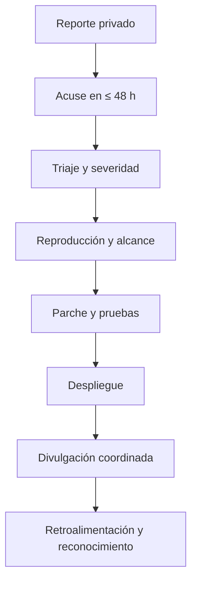

# Política de Seguridad

Numination se toma la seguridad en serio. Este documento explica cómo reportar vulnerabilidades, qué versiones reciben soporte y qué prácticas aplicamos para proteger a usuarios, datos y pagos.

> ## ⚠️ POR FAVOR NO ABRAS UN ISSUE PÚBLICO PARA REPORTAR UNA VULNERABILIDAD
>
> Los issues públicos quedan indexados y exponen a todos los usuarios antes de que exista un parche. Usa el canal privado descrito abajo.

---

## 1. Canal de reporte

Envíanos un correo a:

**📧 [security@numination.com](mailto:security@numination.com)**

Asunto sugerido:

```text
[SECURITY] <componente afectado> — <resumen en una frase>
```

Si el proveedor de correo falla, usa el canal alternativo:

**📧 [seguridad@numination.app](mailto:seguridad@numination.app)**

No publiques detalles técnicos, capturas, tokens ni pruebas de concepto en GitHub, Discord, X ni ningún otro canal público.

---

## 2. Qué incluir en el reporte

Un buen reporte nos permite reproducir y corregir más rápido. Incluye:

| Campo | Detalle |
|---|---|
| Descripción | Qué ocurre y por qué es un problema |
| Componente | Endpoint, módulo, pantalla o integración afectada |
| Pasos para reproducir | Secuencia exacta, sin ambigüedades |
| Impacto | Confidencialidad, integridad, disponibilidad o fraude |
| Prueba de concepto | Requests, payloads o script mínimo |
| Entorno | URL, versión, navegador, sistema operativo |
| Evidencia | Logs o capturas **sin datos de terceros** |
| Mitigación sugerida | Opcional, pero bienvenida |
| Contacto | Nombre o alias y medio seguro para responderte |

No incluyas datos personales de otras personas, credenciales activas ni información de producción que no sea estrictamente necesaria.

---

## 3. Tiempo de respuesta

| Etapa | Compromiso |
|---|---|
| Acuse de recibo | **≤ 48 horas hábiles** |
| Clasificación inicial y severidad | ≤ 5 días hábiles |
| Actualización de estado | Cada 7 días mientras el caso esté abierto |
| Corrección o mitigación | Según severidad, con objetivo de 30 días |
| Divulgación coordinada | Después del parche, con tu aprobación |

Si no recibes acuse en 48 horas, reenvía el correo con el asunto original y añade `[REINTENTO]`. No abras un issue público como alternativa.

### 3.1 Objetivos según severidad

| Severidad | Ejemplos | Objetivo de mitigación |
|---|---|---|
| Crítica | RCE, bypass de autenticación, fuga masiva de datos, fraude de pagos | ≤ 72 horas |
| Alta | IDOR, XSS almacenado, escalada de privilegios, SSRF | ≤ 7 días |
| Media | CSRF limitado, enumeración, fuga de metadatos | ≤ 30 días |
| Baja | Cabeceras faltantes, errores verbosos, mejores prácticas | ≤ 90 días |

Los plazos son objetivos de buena fe, no garantías contractuales. La prioridad real depende de explotabilidad, alcance y número de usuarios afectados.

---

## 4. Versiones soportadas

| Versión | Soporte de seguridad | Notas |
|---|---|---|
| `3.x` | ✅ Soportada | Línea actual; recibe parches |
| `2.x` | ❌ Sin soporte | Actualiza a `3.x` |
| `< 2.0` | ❌ Sin soporte | Sin parches |
| Versiones no publicadas | ❌ Sin soporte | Solo builds oficiales |

La versión actual es **3.3.0**. Solo las versiones publicadas en el repositorio oficial y desplegadas desde `main` reciben soporte.

Si mantienes una instalación propia, eres responsable de aplicar actualizaciones y rotar credenciales.

---

## 5. Alcance

### 5.1 En alcance

- Autenticación, sesiones, JWT y OAuth (Google, GitHub).
- Autorización, IDOR y aislamiento de recursos por usuario.
- Inyección SQL, NoSQL, comandos y plantillas.
- XSS, CSRF, clickjacking y problemas de CSP.
- SSRF, especialmente en webhooks salientes y conectores.
- Pagos, créditos, ledger, idempotencia y webhooks de PayPal.
- Carga de archivos, parsing de PDFs y RAG.
- Fuga de secretos en el repositorio o en respuestas de la API.
- Rate limiting, abuso de cuotas y denegación de servicio aplicativa.
- Prompt injection con impacto real en datos o acciones.
- Configuración de CORS, cookies y cabeceras de seguridad.
- Dependencias con vulnerabilidades explotables en este contexto.

### 5.2 Fuera de alcance

- Ataques físicos o ingeniería social contra el equipo.
- DDoS volumétrico (lo mitiga el proveedor de infraestructura).
- Compromiso total del proveedor cloud.
- Falta de cabeceras sin impacto demostrable.
- Reportes generados automáticamente sin prueba de concepto.
- Ingeniería social, phishing o acceso a cuentas de terceros.
- Pruebas que degraden el servicio, borren datos o afecten a otros usuarios.
- Divulgación de versiones de software sin exploit viable.
- SPF, DKIM o DMARC sin demostración de suplantación.
- Self-XSS que requiera que la víctima pegue código en la consola.
- Clickjacking en páginas sin acciones sensibles.
- Enumeración de usuarios por respuestas genéricas ya documentadas.

Si dudas si algo está en alcance, pregúntanos antes de probarlo.

---

## 6. Reglas de divulgación responsable

Al investigar y reportar, aceptas:

1. **No acceder** a datos que no te pertenecen.
2. **No modificar ni borrar** información de producción.
3. **No interrumpir** el servicio ni degradar la experiencia de otros usuarios.
4. **No extorsionar**, exigir pago ni condicionar la divulgación.
5. **No divulgar** el hallazgo antes de que exista un parche y autorización expresa.
6. **No usar** técnicas de ingeniería social contra empleados o usuarios.
7. **Reportar de inmediato** si accediste accidentalmente a datos sensibles.
8. **Eliminar** cualquier dato obtenido durante la investigación una vez confirmado el reporte.
9. **Respetar** la privacidad de terceros en capturas y logs.
10. **Cumplir** la ley aplicable.

### 6.1 Safe harbor

Si actúas de buena fe, siguiendo esta política y sin causar daño, no iniciaremos acciones legales contra ti por la investigación de seguridad. Esta protección no cubre:

- Extorsión o chantaje.
- Acceso intencional a datos de terceros.
- Daño a la disponibilidad del servicio.
- Uso de datos obtenidos para fines distintos al reporte.
- Violación de leyes aplicables.

La buena fe se evalúa caso por caso. Si tienes dudas, contacta antes de ejecutar la prueba.

---

## 7. Proceso de respuesta



| Fase | Responsable | Resultado |
|---|---|---|
| Recepción | Equipo de seguridad | Ticket privado y acuse |
| Triaje | Mantenedor + seguridad | Severidad y prioridad |
| Reproducción | Investigador + equipo | Confirmación o descarte |
| Corrección | Equipo de ingeniería | Parche con tests |
| Despliegue | DevOps | Producción verificada |
| Divulgación | Ambos | Aviso coordinado |

Durante el proceso mantendremos un canal privado y te informaremos si el reporte se acepta, se necesita más información o se descarta con justificación.

---

## 8. Reconocimiento

No existe un programa formal de bug bounty con recompensas económicas. Los reportes válidos se evalúan caso por caso.

Con tu permiso, podemos:

- Acreditarte en el aviso de seguridad.
- Mencionarte en las notas de la versión.
- Añadirte a una lista de colaboradores de seguridad.

No garantizamos compensación económica, empleo ni contrato por reportar. Tampoco aceptamos condiciones que impliquen pago obligatorio para divulgar.

---

## 9. Mejores prácticas de seguridad de la plataforma

### 9.1 Rate limiting

Numination aplica límites en varias capas para separar tráfico barato de operaciones costosas:

| Capa | Ventana | Límite | Objetivo |
|---|---|---|---|
| Global por IP | 60 s | 500 | Proteger infraestructura |
| Chat / streaming | 60 s | 60 | Evitar abuso de SSE |
| Login | 5 min | 10 | Frenar credential stuffing |
| Registro | 15 min | 5 | Evitar creación masiva de cuentas |
| Operaciones sensibles | 60 s | 10 | Pagos, cambios de cuenta |
| Llamadas a IA | 60 s | 20 | Proteger presupuesto de proveedores |
| Por usuario y plan | 60 s | Según plan | Cuotas comerciales |

Además:

- `trust proxy` se configura según la topología de despliegue.
- Los límites se aplican por IP, por usuario y por email cuando corresponde.
- Los bloqueos por intentos fallidos son progresivos.
- Los errores de rate limiting no filtran información interna.

### 9.2 HMAC en webhooks

Los webhooks salientes se firman con HMAC-SHA256 y un secreto único por endpoint:

```http
POST /tu-endpoint HTTP/1.1
Content-Type: application/json
X-Numination-Signature: sha256=<hex>
X-Numination-Timestamp: <epoch-ms>
```

Recomendaciones para quien consume webhooks:

1. Verifica la firma con comparación en tiempo constante.
2. Rechaza timestamps con más de 5 minutos de antigüedad.
3. Usa el cuerpo **crudo** para calcular el HMAC, no el JSON reserializado.
4. Responde `2xx` rápido y procesa de forma asíncrona.
5. Implementa idempotencia por `event.id`.
6. Rota el secreto si sospechas compromiso.

Ejemplo de verificación:

```js
import crypto from 'node:crypto';

export function verifySignature(rawBody, header, secret) {
  const expected = crypto
    .createHmac('sha256', secret)
    .update(rawBody)
    .digest('hex');

  const received = String(header).replace(/^sha256=/, '');
  const a = Buffer.from(expected);
  const b = Buffer.from(received);

  return a.length === b.length && crypto.timingSafeEqual(a, b);
}
```

### 9.3 Webhooks entrantes de PayPal

- La firma se verifica contra la API de PayPal, no solo con un hash local.
- Se usa el cuerpo crudo (`req.rawBody`).
- Se valida el `cert_url` contra dominios de PayPal.
- La entrega es idempotente: `credits_granted = 0` y ledger único.
- Los eventos desconocidos responden `200` para evitar reintentos infinitos.
- Timeout de procesamiento acotado.

### 9.4 Autenticación y sesiones

- Contraseñas con hash fuerte y salt único.
- Cookies `HttpOnly`, `Secure` en producción y `SameSite=Lax`.
- JWT con `iss`, `aud`, `exp` y `jti` para revocación.
- Validación de `state` en OAuth para prevenir login CSRF.
- Verificación de email antes de operaciones sensibles.
- Bloqueo progresivo tras intentos fallidos.
- Separación de roles `user` y `admin`.

### 9.5 Autorización y datos

- Toda consulta filtra por `user_id` en SQL.
- Los IDs se validan como UUID cuando corresponde.
- Los recursos ajenos devuelven `403` o `404`, nunca datos parciales.
- Los pagos verifican propiedad antes de cualquier operación.
- Los logs no incluyen contenido de mensajes, tokens ni contraseñas.

### 9.6 Validación y saneamiento

- Zod valida el borde de cada request.
- Los strings tienen `.trim()` y `.max()`.
- Los archivos se validan por MIME, tamaño y magic bytes.
- Las URLs dinámicas se sanean contra `javascript:`, `data:` y `vbscript:`.
- El HTML generado por IA se escapa antes de renderizar.
- CSP restringe scripts y `frame-ancestors 'none'` bloquea clickjacking.

### 9.7 Secretos

- `.env`, `.env.*` y `env.local.js` están fuera de Git.
- Cada clave tiene alcance mínimo en su proveedor.
- Rotación periódica de JWT, PayPal y claves de IA.
- Separación estricta entre sandbox y producción.
- Si una clave se filtra: revocar, rotar, revisar logs y documentar.

---

## 10. Si eres usuario y sospechas un incidente

Si crees que tu cuenta fue comprometida:

1. Cambia tu contraseña desde un dispositivo confiable.
2. Cierra sesión en todos los dispositivos.
3. Revisa actividad reciente, chats, memorias y pagos.
4. Escríbenos a [security@numination.com](mailto:security@numination.com).
5. No reenvíes correos sospechosos a otras personas.

Si detectaste un cobro no autorizado, contacta también a PayPal y a [soporte@numination.app](mailto:soporte@numination.app).

---

## 11. Divulgación pública

Coordinamos la divulgación contigo. Cuando el parche esté desplegado:

- Publicamos un aviso con impacto, versiones afectadas y mitigación.
- Acreditamos al investigador si lo autoriza.
- Evitamos detalles que faciliten explotación de instalaciones sin actualizar.
- Podemos retrasar detalles técnicos hasta que la mayoría de instalaciones hayan actualizado.

No divulgues el hallazgo antes de recibir autorización escrita. Si necesitas referenciar el caso, usa un identificador genérico acordado.

---

## 12. Contacto

| Propósito | Correo |
|---|---|
| Vulnerabilidades de seguridad | [security@numination.com](mailto:security@numination.com) |
| Alternativa de seguridad | [seguridad@numination.app](mailto:seguridad@numination.app) |
| Soporte general | [soporte@numination.app](mailto:soporte@numination.app) |
| Privacidad y datos personales | [privacidad@numination.app](mailto:privacidad@numination.app) |

Para asuntos que no sean vulnerabilidades, consulta [`.github/SUPPORT.md`](.github/SUPPORT.md).

---

*Última revisión: octubre de 2026 · Versión de la política: 1.0*
