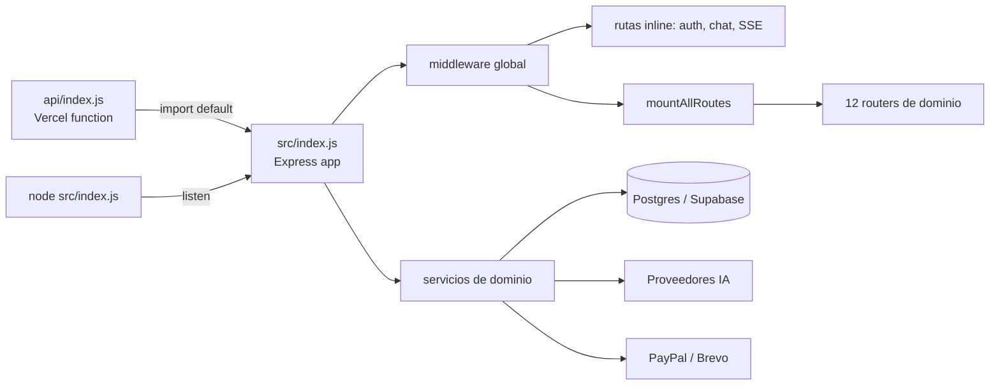
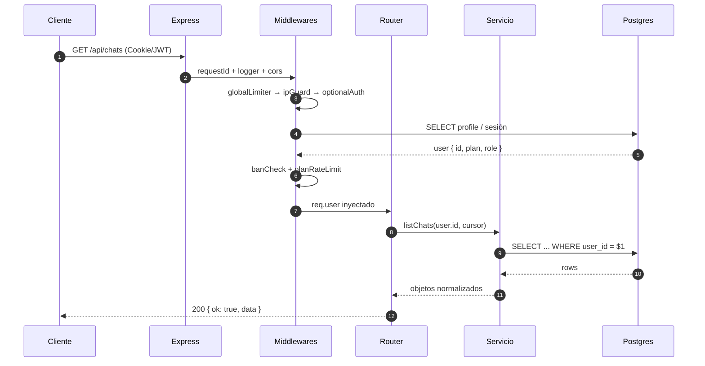
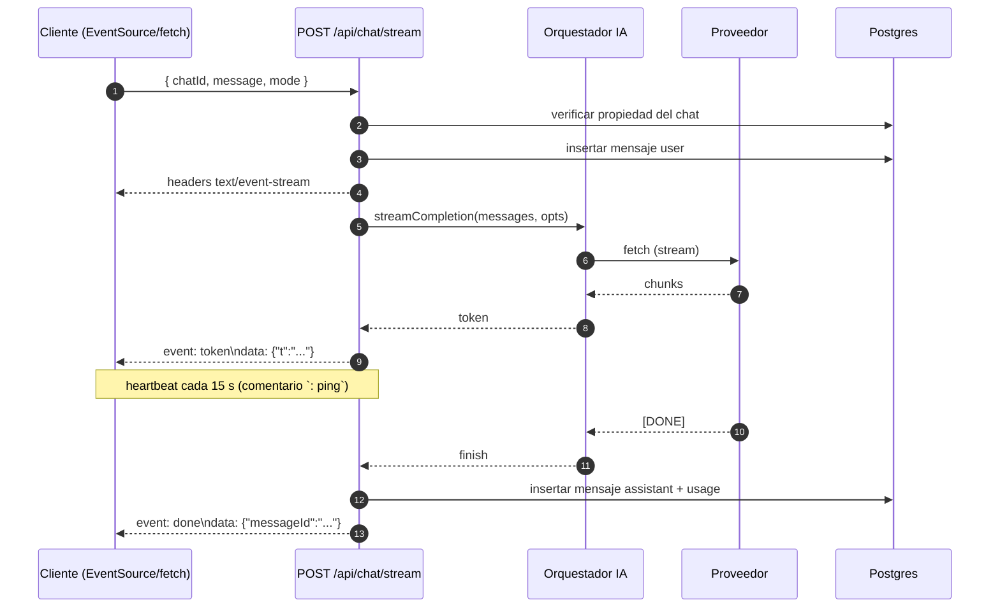

# Arquitectura del Sistema — Numination

> **Audiencia:** arquitectos, backend engineers, nuevos integrantes.
> **Última verificación contra código:** octubre 2026 · `src/index.js`, `src/routes/index.js`, `src/config.js`.

---

## 1. Resumen ejecutivo

Numination es un **monolito modular** desplegable en dos topologías incompatibles entre sí:

| Topología | Cuándo | Entrada | Estado |
|---|---|---|---|
| **Long-running Node 22** | Desarrollo, VPS, Docker, Railway | `node src/index.js` → `app.listen(PORT)` | Completa |
| **Serverless Vercel** | Producción `numination.app` | `api/index.js` → exporta `app` | Limitada (sin estáticos, sin timers) |

El mismo objeto Express se exporta por defecto desde `src/index.js`. En Vercel, `api/index.js` importa ese default y lo entrega al runtime; cuando `process.env.VERCEL === '1'`, el arranque de `app.listen` y el `express.static` se omiten deliberadamente.



### Por qué monolito modular

1. **Un solo deploy** para 75+ endpoints y 4 productos.
2. **Contratos compartidos** (`config.js`, `lib/http.js`) sin versionado de paquetes.
3. **Sin latencia de red interna**: chat → RAG → memoria es una llamada de función.
4. **Migración futura posible**: cada router bajo `src/routes/` ya es un candidato natural a servicio, porque solo depende de `db`, `config` y utilidades.

---

## 2. Capas

```text
┌────────────────────────────────────────────────────────────┐
│ L0 · Presentación                                          │
│ public/*.html · assets/js/* · assets/css/*                 │
├────────────────────────────────────────────────────────────┤
│ L1 · Transporte HTTP                                       │
│ Express 5 · cors · helmet-ish headers · cookie-parser      │
│ express.json({ verify: rawBody }) · compression            │
├────────────────────────────────────────────────────────────┤
│ L2 · Borde (cross-cutting)                                 │
│ requestId · logger · rate limit · ipGuard · auth · ban     │
│ errorHandler · notFound                                     │
├────────────────────────────────────────────────────────────┤
│ L3 · Rutas / controladores                                 │
│ src/index.js (inline) · src/routes/* · src/payments/routes │
├────────────────────────────────────────────────────────────┤
│ L4 · Dominio (servicios)                                   │
│ src/services/* · src/payments/database.js · src/lib/*      │
├────────────────────────────────────────────────────────────┤
│ L5 · Persistencia y terceros                               │
│ postgres.js (Supabase pooler) · pgvector · PayPal · IA     │
└────────────────────────────────────────────────────────────┘
```

### Regla de dependencias

```
L0 → L1 → L2 → L3 → L4 → L5
```

Nunca al revés. Un servicio (L4) **no** conoce `req`/`res`. Un router (L3) **no** ejecuta SQL crudo salvo en módulos legacy (`chats.js`, `memories.js`), que son deuda técnica identificada.

---

## 3. Orden exacto del middleware

El orden importa: invertir dos capas rompe autenticación o el `rawBody` de PayPal.

```js
// src/index.js (resumen fiel)
app.set('trust proxy', 1);
app.use(requestId);
app.use(loggerMiddleware);
app.use(cors({ origin: allowlist, credentials: true }));
app.use(helmetLite);
app.use(compression());
app.use(cookieParser());
app.use('/api/payments/webhook', express.raw({ type: 'application/json' })); // ver nota
app.use(express.json({
  limit: '12mb',
  verify: (req, _res, buf) => {
    if (req.originalUrl.startsWith('/api/payments/webhook')) req.rawBody = buf;
  }
}));
app.use(express.urlencoded({ extended: true, limit: '2mb' }));
app.use('/api', globalLimiter);      // 500 req / 60 s por IP
app.use('/api', ipGuard);            // overrides por ruta
app.use(optionalAuth);               // decodifica JWT si existe
app.use(banCheck);                   // bloquea suspendidos
app.use(planRateLimit);              // límite por plan
```

### Detalle crítico: `rawBody`

La firma de PayPal se calcula sobre el **cuerpo crudo**. `express.json` consume el stream, por lo que el `verify` guarda el `Buffer` en `req.rawBody`. Solo se guarda para URLs que empiezan por `/api/payments/webhook`, para no duplicar memoria en el resto del tráfico.

> ⚠️ Si agregas un parser JSON global **antes** de este bloque, el webhook recibirá `{}` y la verificación fallará con 401 `Firma inválida.`

---

## 4. Ciclo de vida de una request

### 4.1 Petición autenticada normal



### 4.2 Chat con streaming (SSE)



Reglas del SSE implementadas:

| Regla | Valor | Motivo |
|---|---|---|
| `Content-Type` | `text/event-stream` | Estándar |
| `Cache-Control` | `no-cache, no-transform` | Evitar buffers de proxy |
| `Connection` | `keep-alive` | Persistencia |
| `X-Accel-Buffering` | `no` | Desactiva buffer de Nginx |
| Heartbeat | 15 s | Evitar timeout de Vercel/Cloudflare |
| Timeout duro | 90 s | Cortar streams colgados |
| Cierre | `res.end()` en `done` **y** en `error` | Evitar sockets zombies |

---

## 5. Mapa de routers

`src/routes/index.js` exporta `mountAllRoutes(app)` y monta, en este orden:

| # | Prefijo | Archivo | Responsabilidad |
|---|---|---|---|
| 1 | `/api/admin` | `admin.routes.js` | Usuarios, planes, flags, métricas |
| 2 | `/api/rag` | `rag.routes.js` | Upload, index, query, delete |
| 3 | `/api/images` | `images.routes.js` | Generación y galería |
| 4 | `/api/voice` | `voice.routes.js` | TTS/STT |
| 5 | `/api/personas` | `personas.routes.js` | CRUD de personas |
| 6 | `/api/memory-vault` | `memory-vault.routes.js` | Bóveda de memoria |
| 7 | `/api/sandbox` | `sandbox.routes.js` | Ejecución simulada |
| 8 | `/api/search` | `search.routes.js` | Búsqueda web |
| 9 | `/api/prompts` | `prompts.routes.js` | Biblioteca de prompts |
| 10 | `/api/flags` | `flags.routes.js` | Feature flags |
| 11 | `/api/notifications` | `notifications.routes.js` | In-app + email |
| 12 | `/api/billing` | `billing.routes.js` | Plan, créditos, historial |

Además, **inline** en `src/index.js`:

- `POST /api/auth/register`, `/login`, `/logout`, `/refresh`
- `GET /api/auth/google`, `/api/auth/google/callback`
- `GET /api/auth/github`, `/api/auth/github/callback`
- `GET /api/me`
- `GET|POST|PATCH|DELETE /api/chats`
- `POST /api/chat/stream`
- `GET /api/health`, `/api/version`, `/api/endpoints`
- `POST /api/payments/*` (montado desde `src/payments/routes.js`)

---

## 6. Patrones de diseño aplicados

| Patrón | Dónde | Por qué |
|---|---|---|
| **Chain of Responsibility** | Cascada IA (`Groq → Gemini → Kimi`) | Cada proveedor intenta; si falla, pasa al siguiente |
| **Strategy** | `src/services/*` seleccionan implementación por `mode` | Chat normal vs coder vs RAG |
| **Circuit Breaker (soft)** | Cooldown por API key de Gemini | Evita martillar una key agotada |
| **Repository (parcial)** | `src/payments/database.js` | Aísla SQL de la lógica HTTP |
| **Idempotency Key** | `payment_idempotency` | Doble click en "Pagar" no crea dos órdenes |
| **Decorator** | `withAuth`, `withPlan` | Envuelven handlers sin duplicar checks |
| **Observer** | Webhooks salientes + notificaciones | Desacopla efectos secundarios |
| **Graceful Degradation** | RAG sin pgvector, DB caída | La app sigue viva en modo limitado |

### Ejemplo: cadena de IA

```js
// pseudo-fiel a src/index.js
const chain = config.ai.fallbackChain; // ['groq','gemini','kimi']
for (const provider of chain) {
  try {
    return await callProvider(provider, payload, signal);
  } catch (err) {
    logger.warn({ provider, err: err.message }, 'provider failed');
    continue;
  }
}
throw new AppError('ALL_PROVIDERS_FAILED', 503);
```

---

## 7. Gestión de configuración

`src/config.js` es la **única** fuente de verdad. No se lee `process.env` fuera de ahí (excepto tests y scripts).

```js
export const config = {
  env: process.env.NODE_ENV || 'development',
  port: Number(process.env.PORT || 8080),
  database: { url: process.env.DATABASE_URL, ssl: ... },
  auth: { jwtSecret, sessionTtl, google, github },
  ai: {
    fallbackChain: ['groq', 'gemini', 'kimi'],
    groq:   { apiKey, model: '...' },
    gemini: { keys: [k1, k2, k3], model: '...' },
    kimi:   { apiKey, model: '...' }
  },
  payments: { paypal: { clientId, secret, mode, webhookId } },
  limits: { global: 500, chat: 60, strict: 10, ai: 20 }
};
```

### Validación al arranque

Si `JWT_SECRET` falta en producción, el proceso **no arranca**. Si falta una key de IA, se registra un warning y ese proveedor se omite de la cadena efectiva. Esto evita el clásico "arrancó bien y falló en la primera request".

---

## 8. Errores y contrato de respuesta

```ts
type Ok<T>  = { ok: true; data: T; requestId: string };
type Err    = { ok: false; error: string; code: string; requestId: string; details?: unknown };
```

| Código HTTP | `code` típico | Cuándo |
|---|---|---|
| 400 | `VALIDATION_ERROR` | Zod falla |
| 401 | `UNAUTHORIZED` / `Firma inválida.` | Sin token / webhook inválido |
| 403 | `PAYMENT_ORDER_FORBIDDEN` | IDOR detectado |
| 404 | `NOT_FOUND` | Recurso inexistente o ajeno |
| 409 | `CONFLICT` | Email duplicado |
| 429 | `RATE_LIMITED` | Límite excedido |
| 500 | `INTERNAL` | Excepción no controlada |
| 503 | `ALL_PROVIDERS_FAILED` | Cascada IA agotada |

`errorHandler` nunca filtra `err.stack` al cliente; lo loguea con `requestId` y devuelve un mensaje genérico en producción.

---

## 9. Despliegue y restricciones serverless

`vercel.json`:

```json
{
  "cleanUrls": true,
  "outputDirectory": "public",
  "rewrites": [{ "source": "/api/(.*)", "destination": "/api" }]
}
```

Consecuencias:

| Restricción | Impacto | Mitigación |
|---|---|---|
| Sin procesos en background | Colas y cron no corren | Webhooks + triggers de DB |
| Timeout de función | SSE largo se corta | Heartbeat + reconexión cliente |
| Sin FS persistente | Uploads a disco se pierden | Guardar en Supabase Storage |
| Cold start | Primera request lenta | Pool de conexiones y lazy init |
| Un solo `api/index.js` | Todo el backend es una función | Aceptable para el volumen actual |

> En Vercel, `app.listen` y `express.static` están guardados por `if (process.env.VERCEL !== '1')`. Si los quitas, el build falla en runtime.

---

## 10. Observabilidad

| Señal | Implementación | Dónde verla |
|---|---|---|
| `requestId` | `crypto.randomUUID()` en header `x-request-id` | Logs y respuesta de error |
| Logs estructurados | JSON por línea | stdout del host |
| Latencia por proveedor | `logger.info({ provider, ms })` | Logs |
| Fallos de IA | `logger.warn({ provider, status })` | Logs |
| Auditoría de pagos | `payment_audit_log` | Postgres |
| Intentos IDOR | `logIdorAttempt()` | Postgres / logs |
| Endpoints vivos | `GET /api/endpoints` | Navegador |

### Métricas que **no** existen todavía

- OpenTelemetry / trazas distribuidas.
- Prometheus / Grafana.
- Alertas automáticas de caída de proveedor.
- Dashboard de latencia p95.

Están listadas en [`roadmap.md`](./roadmap.md) como Fase 2.

---

## 11. Deuda técnica conocida

| # | Problema | Archivo | Severidad |
|---|---|---|---|
| 1 | `migrations/001` apunta a `messages` (minúscula) pero el runtime usa `"Message"` | `migrations/001_*` | Alta |
| 2 | `rag_chunks.embedding` sin índice HNSW/ivfflat → scan secuencial | migración RAG | Media |
| 3 | Webhook puede otorgar 0 créditos si `credits_granted` aún es 0 | `src/payments/webhooks.js` | Alta |
| 4 | `"Message"` sin columna `provider` | esquema | Baja |
| 5 | SQL crudo en `chats.js` / `memories.js` | `src/` | Media |
| 6 | Sin cobertura medida | `tests/` | Media |
| 7 | Frontend con globals (`window.Escritura`) | `public/assets/js` | Baja |

Cada uno tiene su entrada en [`troubleshooting.md`](./troubleshooting.md).

---

## 12. Cómo agregar un módulo nuevo

1. Crear `src/routes/mi-modulo.routes.js` con `export default function mount(app) {}`.
2. Registrar en `src/routes/index.js` **al final** (para no romper precedencia).
3. Poner la lógica en `src/services/mi-modulo.js` — sin `req`/`res`.
4. Validar input con Zod en el borde.
5. Usar `withAuth` y, si aplica, `requirePlan('pro')`.
6. Añadir tests en `tests/`.
7. Documentar el endpoint en [`api-reference.md`](./api-reference.md).

```js
// src/routes/ejemplo.routes.js
import { z } from 'zod';
import { withAuth } from '../middleware/auth.js';
import { ok, fail } from '../lib/http.js';
import { crearRecurso } from '../services/ejemplo.js';

const Body = z.object({ nombre: z.string().min(1).max(80) });

export default function mountEjemplo(app) {
  app.post('/api/ejemplo', withAuth, async (req, res, next) => {
    try {
      const body = Body.parse(req.body);
      const data = await crearRecurso(req.user.id, body.nombre);
      return ok(res, data, 201);
    } catch (err) { next(err); }
  });
}
```

---

## 13. Preguntas frecuentes de arquitectura

**¿Por qué no Next.js?**
El producto requiere SSE de larga duración, control fino de headers y ningún build step en el cliente. Express da eso sin fricción. El costo es servir HTML estático manualmente.

**¿Por qué Supabase y no Postgres propio?**
Auth, storage, pooler y pgvector en un solo proveedor. El esquema sigue siendo Postgres estándar, así que la salida es un `pg_dump`.

**¿Por qué tres keys de Gemini?**
El free tier agota por minuto. La rotación con cooldown multiplica la cuota efectiva sin pagar. Ver [`ai-orchestration.md`](./ai-orchestration.md).

**¿Se puede escalar horizontalmente?**
Sí, con una condición: las sesiones y la idempotencia viven en Postgres, no en memoria del proceso. La única excepción es el caché en memoria de `src/lib/cache.js`, que es best-effort por instancia.

---

*Siguiente lectura recomendada: [`database-schema.md`](./database-schema.md) para entender el modelo de datos, y [`ai-orchestration.md`](./ai-orchestration.md) para el corazón del producto.*
