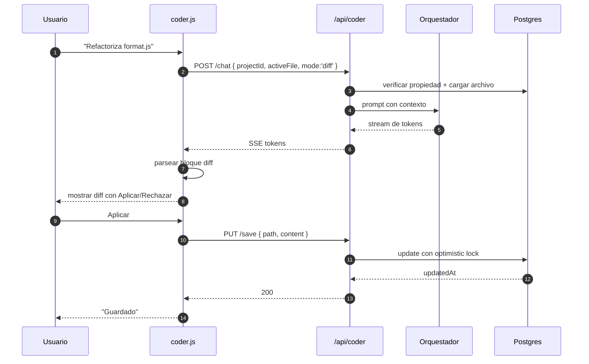

# Módulo Coder (IDE en el navegador)

> **Archivos:** `src/coder.js`, `api/coder/*`, `public/coder.html`, `public/assets/js/coder.js` (1 973 LOC), `services/coder-*`.
> **Naturaleza:** IDE simulado. **No** ejecuta código arbitrario en el servidor.

---

## 1. Qué es y qué no es

| Es | No es |
|---|---|
| Editor con resaltado y file tree | Un runtime de contenedores |
| Chat contextual sobre el proyecto | Un reemplazo de VS Code |
| Diff viewer para propuestas de la IA | Un sistema de control de versiones real |
| Persistencia de archivos en Postgres | Un filesystem |
| Terminal simulada (comandos whitelist) | Una shell del sistema |

La decisión de **no ejecutar código** es deliberada: un sandbox real requiere aislamiento a nivel de kernel (gVisor, Firecracker) y ese costo no se justifica para el caso de uso actual. La "ejecución" se resuelve con un intérprete de comandos seguro y respuestas simuladas.

---

## 2. Arquitectura del módulo

```mermaid
flowchart LR
    subgraph Cliente
        A[coder.html]
        B[coder.js<br/>estado + render]
        C[editor: textarea + highlight]
        D[file tree]
        E[terminal UI]
        F[diff viewer]
    end

    subgraph Servidor
        G[/api/coder/load]
        H[/api/coder/save]
        I[/api/coder/chat]
        J[/api/coder/execute]
        K[_store.js]
    end

    subgraph Datos
        L[(projects)]
        M[(project_files)]
    end

    B --> C
    B --> D
    B --> E
    B --> F
    B -->|GET| G
    B -->|PUT| H
    B -->|POST SSE| I
    B -->|POST| J
    G --> K
    H --> K
    I --> K
    J --> K
    K --> L
    K --> M
```

---

## 3. Endpoints

| Método | Ruta | Body | Respuesta |
|---|---|---|---|
| `GET` | `/api/coder/load?projectId=` | — | `{ project, files[] }` |
| `POST` | `/api/coder/projects` | `{ name }` | `{ id, name }` |
| `PUT` | `/api/coder/save` | `{ projectId, path, content }` | `{ ok, updatedAt }` |
| `DELETE` | `/api/coder/files?projectId=&path=` | — | `{ ok }` |
| `POST` | `/api/coder/chat` | `{ projectId, message, activeFile }` | SSE |
| `POST` | `/api/coder/execute` | `{ projectId, command }` | `{ stdout, stderr, exitCode }` |
| `GET` | `/api/coder/export?projectId=` | — | ZIP / JSON |

### Autenticación

Todos requieren JWT. Cada operación verifica propiedad del proyecto:

```js
const [project] = await sql`
  select id from projects where id = ${projectId} and user_id = ${userId}
`;
if (!project) return fail(res, 404, 'PROJECT_NOT_FOUND');
```

Sin ese check, cualquier usuario podría leer archivos ajenos con un UUID adivinado (IDOR).

---

## 4. Modelo de datos

```sql
create table if not exists projects (
  id         uuid primary key default gen_random_uuid(),
  user_id    uuid not null references profiles(id) on delete cascade,
  name       text not null,
  language   text default 'javascript',
  created_at timestamptz not null default now(),
  updated_at timestamptz not null default now()
);

create table if not exists project_files (
  id         uuid primary key default gen_random_uuid(),
  project_id uuid not null references projects(id) on delete cascade,
  path       text not null,
  content    text not null default '',
  size_bytes integer not null default 0,
  updated_at timestamptz not null default now(),
  unique (project_id, path)
);

create index if not exists idx_project_files_project on project_files (project_id);
```

### Reglas de `path`

| Regla | Motivo |
|---|---|
| Relativo, sin `..` | Evitar traversal |
| Separador `/` siempre | Consistencia multiplataforma |
| Sin `\0` | Evitar truncamiento en C |
| Longitud ≤ 255 | Límite de nombre |
| Sin espacios al inicio/fin | Evitar duplicados invisibles |
| Máx. 500 archivos por proyecto | Límite de UI y payload |

```js
function isValidPath(p) {
  if (typeof p !== 'string' || !p.length || p.length > 255) return false;
  if (p.includes('\0') || p.includes('..') || p.startsWith('/')) return false;
  if (p.trim() !== p) return false;
  return /^[a-zA-Z0-9._\-\/]+$/.test(p);
}
```

---

## 5. Editor

### Implementación

No hay Monaco ni CodeMirror. El editor es un `<textarea>` con un `<pre>` superpuesto para el resaltado, más un `highlight()` propio en `coder.js`.

| Capa | Función |
|---|---|
| `textarea` | Captura de input, selección, undo nativo |
| `pre.highlight` | Render con `<span class="tok-*">` |
| Scroll sync | `textarea.onscroll → pre.scrollTop/Left` |
| Tab | Inserta 2 espacios, no cambia foco |
| Auto-cierre | `(`, `[`, `{`, `"`, `'`, `` ` `` |

### Ventajas

- **Cero dependencias**, cero build step.
- Carga instantánea en móvil.
- El estado es texto plano: trivial de guardar.

### Limitaciones

- Sin autocompletado semántico.
- Sin plegado de código.
- Sin soporte multi-cursor.
- El resaltado es por regex, no por parser real.

### Regla de oro del `highlight()`

**Escapar primero, resaltar después.** Si se resalta antes de escapar, el HTML del usuario se inyecta.

```js
function escapeHTML(s) {
  return s
    .replace(/&/g, '&amp;')
    .replace(/</g, '&lt;')
    .replace(/>/g, '&gt;')
    .replace(/"/g, '&quot;')
    .replace(/'/g, '&#39;');
}

function highlight(code) {
  let safe = escapeHTML(code);
  safe = safe.replace(/(\/\*[\s\S]*?\*\/|\/\/[^\n]*)/g, '<span class="tok-com">$1</span>');
  safe = safe.replace(/(&quot;[^&]*?&quot;|&#39;[^&]*?&#39;)/g, '<span class="tok-str">$1</span>');
  safe = safe.replace(/\b(const|let|var|function|return|if|else|for|while|class|import|export|await|async)\b/g,
                      '<span class="tok-kw">$1</span>');
  return safe;
}
```

> Ver [`frontend-guide.md`](./frontend-guide.md) para el detalle de XSS y `sanitizeURL`.

---

## 6. File tree

```text
src/
├── index.js
├── utils/
│   ├── format.js
│   └── parse.js
└── styles.css
```

Construcción:

1. Lista plana de `path`.
2. Se divide por `/`.
3. Se inserta en un árbol de objetos.
4. Se ordenan carpetas antes que archivos, alfabéticamente.
5. Render recursivo con indentación por profundidad.

```js
function buildTree(paths) {
  const root = { children: new Map() };
  for (const p of paths) {
    let node = root;
    for (const part of p.split('/')) {
      if (!node.children.has(part)) node.children.set(part, { name: part, children: new Map() });
      node = node.children.get(part);
    }
    node.isFile = true;
  }
  return root;
}
```

| Acción | Atajo |
|---|---|
| Nuevo archivo | `Ctrl/Cmd + N` |
| Nuevo folder | `Ctrl/Cmd + Shift + N` |
| Renombrar | `F2` |
| Borrar | `Delete` (con confirmación) |
| Abrir | `Enter` / click |

---

## 7. Chat contextual

`POST /api/coder/chat` recibe el proyecto y el archivo activo, y responde por SSE.

### Contexto inyectado

| Pieza | Límite |
|---|---|
| Nombre del proyecto | 100 chars |
| Archivo activo | 8 000 chars |
| Archivos abiertos | 3 × 4 000 chars |
| Estructura del proyecto | Lista de paths (≤ 200) |
| Mensaje del usuario | 4 000 chars |
| Historial de conversación | 10 turnos |

### Prompts de sistema

`services/coder-prompts.js` define modos:

| Modo | Comportamiento |
|---|---|
| `explain` | Explica sin modificar |
| `edit` | Devuelve el archivo completo modificado |
| `diff` | Devuelve sólo el diff unificado |
| `test` | Genera tests |
| `review` | Lista problemas y severidad |

### Contrato de respuesta para `edit`

El modelo debe devolver un bloque con un marcador estable:

````text
```javascript filename="src/utils/format.js"
// contenido completo
```
````

El cliente parsea el `filename` y muestra un botón "Aplicar". Nunca se aplica automáticamente: el usuario confirma.

---

## 8. Diff viewer

### Formato aceptado

```diff
--- a/src/utils/format.js
+++ b/src/utils/format.js
@@ -3,7 +3,7 @@
 export function format(n) {
-  return n.toFixed(2);
+  return new Intl.NumberFormat('es-CO').format(n);
 }
```

### Render

| Prefijo | Clase | Color |
|---|---|---|
| `+` | `diff-add` | Verde |
| `-` | `diff-del` | Rojo |
| `@@` | `diff-hunk` | Azul |
| ` ` | `diff-ctx` | Gris |

### Aplicación

1. Parsear hunks.
2. Verificar que el contexto coincide con el archivo actual (si no, marcar conflicto).
3. Aplicar de abajo hacia arriba para no desplazar índices.
4. Guardar con `PUT /api/coder/save`.

> Si el archivo cambió desde que se generó el diff, se rechaza con `STALE_DIFF` y se pide regenerar. Aplicar a ciegas corrompe código.

---

## 9. Terminal simulada

`POST /api/coder/execute` **no** lanza procesos. Interpreta un conjunto cerrado de comandos.

### Comandos soportados

| Comando | Comportamiento |
|---|---|
| `ls [path]` | Lista hijos del path |
| `cat <file>` | Devuelve contenido |
| `pwd` | `/workspace/<project>` |
| `cd <path>` | Cambia directorio virtual |
| `echo <text>` | Imprime texto |
| `clear` | Vacía la terminal (cliente) |
| `help` | Lista comandos |
| `node <file>` | Simula ejecución: devuelve eco del código + nota |
| `npm install` | Simulado, sin red |
| `git status` | Simulado |

### Comandos **bloqueados**

`rm -rf`, `curl`, `wget`, `ssh`, `sudo`, cualquier `;`, `|`, `&&`, `>`, `$(...)` y backticks.

```js
const FORBIDDEN = /[;|&><`$()]|\b(rm|sudo|curl|wget|ssh|nc|bash|sh)\b/;
if (FORBIDDEN.test(cmd)) {
  return { stdout: '', stderr: 'Comando no permitido en el sandbox.', exitCode: 126 };
}
```

### Por qué

Cualquier ejecución real en el host es RCE. Incluso con `child_process.exec` y listas negras, el escape es trivial (`$(...)`, variables de entorno, binarios alternativos). La única forma segura es un contenedor con seccomp y sin red, que está fuera del alcance actual.

---

## 10. Persistencia y concurrencia

| Escenario | Comportamiento |
|---|---|
| Guardado manual (`Ctrl+S`) | `PUT` con `path` + `content` |
| Autoguardado | Cada 3 s si hay cambios y el editor tiene foco |
| Conflicto de versión | Se compara `updated_at`; si difiere, 409 `STALE_WRITE` |
| Archivo borrado en otra pestaña | El guardado recrea el registro |
| Proyecto borrado | `404 PROJECT_NOT_FOUND` |

### Optimistic locking

```sql
update project_files
set content = $3, size_bytes = length($3), updated_at = now()
where project_id = $1 and path = $2 and updated_at = $4
returning updated_at;
```

Si `rowCount = 0`, el archivo cambió. Se devuelve el contenido actual para que el cliente resuelva.

---

## 11. Límites

| Límite | Valor | Motivo |
|---|---|---|
| Tamaño de archivo | 256 KB | Payload y render |
| Archivos por proyecto | 500 | UI |
| Proyectos por usuario (free) | 3 | Plan |
| Proyectos por usuario (pro) | 50 | Plan |
| Mensaje de chat | 4 000 chars | Contexto |
| Timeout de chat | 60 s | SSE |

---

## 12. Flujo completo de una edición asistida



---

## 13. Deuda técnica del módulo

| # | Problema | Impacto |
|---|---|---|
| 1 | Resaltado por regex, no parser | Errores en strings anidados |
| 2 | Sin autocompletado | UX inferior a VS Code |
| 3 | Terminal simulada | Expectativa incumplida si el usuario espera ejecución real |
| 4 | Sin control de versiones | No hay historial ni rollback |
| 5 | Autoguardado sin debounce robusto | Requests innecesarios |
| 6 | Sin tests de UI | Regresiones silenciosas |

### Mejoras propuestas

1. Integrar CodeMirror 6 vía CDN (sin build step) para resaltado real.
2. Historial de versiones en `project_file_versions`.
3. Ejecución real en WebContainer (StackBlitz) del lado del cliente — sin riesgo en servidor.
4. Búsqueda global en el proyecto (`Ctrl+Shift+F`).

Ver [`roadmap.md`](./roadmap.md).

---

## 14. Checklist para tocar el módulo

- [ ] ¿Validaste `path` contra traversal?
- [ ] ¿Verificaste `user_id` del proyecto?
- [ ] ¿Escapaste antes de resaltar?
- [ ] ¿El diff se aplica sólo si el contexto coincide?
- [ ] ¿El autoguardado no pisa cambios remotos?
- [ ] ¿El comando nuevo está en la whitelist y no abre shell?
- [ ] ¿Respeta los límites de tamaño?
- [ ] ¿Funciona sin JavaScript moderno en Safari iOS?
