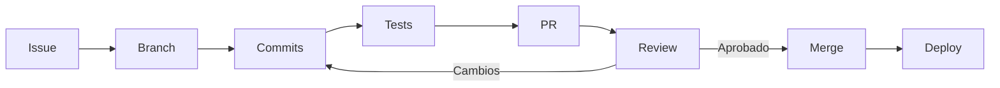

# Contribuir

> **Licencia:** propietaria. Contribuir **no** otorga derechos sobre la obra. Ver [`LICENSE.md`](./LICENSE.md).
> **Regla cero:** si no puedes explicar el cambio en una frase, es demasiado grande.

---

## 1. Antes de empezar

| Requisito | Detalle |
|---|---|
| Acuerdo de contribución | Cesión de derechos patrimoniales al titular |
| Entorno | Ver [`installation.md`](./installation.md) |
| Rama base | `main` |
| Estilo | Convenciones de este documento |
| Tests | Obligatorios para lógica de negocio |

Numination es **software propietario**. Enviar un PR implica aceptar que el código pasa a ser propiedad exclusiva del titular. Si eso no es aceptable, no envíes el PR.

---

## 2. Flujo de trabajo



### 2.1 Crear la rama

```bash
git checkout main
git pull --ff-only
git checkout -b feat/nombre-corto
```

| Prefijo | Uso |
|---|---|
| `feat/` | Nueva funcionalidad |
| `fix/` | Corrección de bug |
| `docs/` | Sólo documentación |
| `refactor/` | Cambio interno sin alterar comportamiento |
| `test/` | Sólo tests |
| `chore/` | Tooling, dependencias |
| `hotfix/` | Urgente sobre producción |

### 2.2 Commits

Formato **Conventional Commits**:

```text
<tipo>(<alcance>): <descripción en imperativo>

[cuerpo opcional]

[footer opcional]
```

Ejemplos:

```text
feat(payments): otorgar créditos desde el catálogo en webhook
fix(rag): crear índice HNSW en rag_chunks
docs(api): documentar /api/coder/execute
refactor(auth): extraer verificación de jti a middleware
test(payments): cubrir replay de webhook
chore(deps): actualizar express a 5.2.1
```

| Regla | Detalle |
|---|---|
| Imperativo | "añade", no "añadido" |
| Minúsculas | Salvo nombres propios |
| Sin punto final | En el asunto |
| Asunto ≤ 72 chars | Legible en `git log --oneline` |
| Un cambio lógico | No mezclar refactor y feature |

### 2.3 Antes del PR

```bash
npm ci
npm test
npm audit --omit=dev
git diff main --stat
```

Checklist:

- [ ] La rama está actualizada con `main`
- [ ] Tests pasan
- [ ] Sin `console.log` de depuración
- [ ] Sin secretos
- [ ] Sin `TODO` sin issue asociado
- [ ] Documentación actualizada si cambia un contrato

---

## 3. Estándares de código

### 3.1 Generales

| Regla | Detalle |
|---|---|
| Módulos | ESM, `import`/`export` |
| Comillas | Simples en JS |
| Punto y coma | Sí |
| Indentación | 2 espacios |
| Longitud de línea | ≤ 100 |
| Fin de línea | LF |
| Encoding | UTF-8 |

### 3.2 Nombres

| Elemento | Convención | Ejemplo |
|---|---|---|
| Archivos de servicio | `kebab-case.js` | `long-term-memory.js` |
| Archivos de ruta | `kebab-case.routes.js` | `rag.routes.js` |
| Variables / funciones | `camelCase` | `getUserById` |
| Constantes | `UPPER_SNAKE` | `PLAN_CATALOG` |
| Clases | `PascalCase` | `AppError` |
| Booleanos | `is`/`has`/`can` | `isActive` |
| Tablas DB | snake_case o PascalCase existente | `payment_orders`, `"Chat"` |

### 3.3 Funciones

```js
// ✅ Una responsabilidad, retorno explícito
export async function findOrderByPaypalId(orderId) {
  const [row] = await sql`
    select * from payment_orders where paypal_order_id = ${orderId}
  `;
  return row ?? null;
}

// ❌ Mezcla HTTP, negocio y persistencia
app.get('/orders/:id', async (req, res) => {
  const o = await sql`...`;
  if (o.status === 'x') { /* ... */ }
  res.json(o);
});
```

| Regla | Detalle |
|---|---|
| Máximo ~40 líneas | Si excede, extraer |
| Máximo 4 parámetros | Si excede, usar objeto |
| Sin efectos secundarios ocultos | El nombre debe reflejarlos |
| Errores explícitos | `throw`, no `return null` silencioso |

### 3.4 Errores

```js
export class AppError extends Error {
  constructor(code, status = 400, details = null) {
    super(code);
    this.code = code;
    this.status = status;
    this.details = details;
  }
}

// uso
throw new AppError('PLAN_NOT_FOUND', 404);
```

| Regla | Detalle |
|---|---|
| Nunca `throw 'string'` | Siempre `Error` |
| Código estable | `UPPER_SNAKE`, no texto libre |
| Sin stack al cliente | `errorHandler` lo corta |
| Log con `requestId` | Correlación |

### 3.5 Logging

```js
logger.info({ requestId, userId, action: 'chat.completed', ms });
logger.warn({ provider: 'groq', status: 429 }, 'provider rate limited');
logger.error({ requestId, err: err.message }, 'capture failed');
```

Prohibido:

```js
console.log(user);            // PII
console.log(req.body);        // secretos
console.log(token);           // credencial
```

---

## 4. Tests

### 4.1 Runner

`node:test` nativo. Sin Jest, sin Mocha.

```js
import { test, describe } from 'node:test';
import assert from 'node:assert/strict';

describe('PLAN_CATALOG', () => {
  test('pro cuesta 7.50 USD y da 500 créditos', () => {
    assert.equal(PLAN_CATALOG.pro.priceUsd, 7.5);
    assert.equal(PLAN_CATALOG.pro.credits, 500);
  });

  test('todos los planes duran 30 días', () => {
    for (const plan of Object.values(PLAN_CATALOG)) {
      assert.equal(plan.days, 30);
    }
  });
});
```

### 4.2 Qué probar

| Capa | Obligatorio |
|---|---|
| Lógica de dinero | ✅ Siempre |
| Autorización | ✅ Siempre |
| Validación de entrada | ✅ |
| Servicios puros | ✅ |
| Endpoints | ✅ al menos happy path + 401 |
| Frontend | ⚠️ Recomendado |

### 4.3 Nombres de test

```js
test('devuelve 403 si la orden pertenece a otro usuario', ...)
test('no otorga créditos dos veces con el mismo orderId', ...)
test('rechaza webhook sin rawBody', ...)
```

El nombre debe describir el comportamiento, no la implementación.

### 4.4 Cobertura

```bash
node --test --experimental-test-coverage
```

| Área | Objetivo |
|---|---|
| `src/payments` | ≥ 70 % |
| `src/middleware` | ≥ 60 % |
| `src/services` | ≥ 50 % |
| Global | ≥ 40 % |

---

## 5. Pull Request

### 5.1 Título

Igual que el commit principal:

```text
feat(payments): otorgar créditos desde el catálogo en webhook
```

### 5.2 Descripción

```markdown
## Qué
Corrige el otorgamiento de créditos cuando el pago se completa sólo por webhook.

## Por qué
El handler usaba `payment.credits_granted`, que es 0 antes del capture.
El usuario pagaba y recibía 0 créditos.

## Cómo
- Resuelve créditos desde `PLAN_CATALOG[order.plan_id]`
- Actualiza con guardia `where credits_granted = 0`
- Añade test de replay

## Riesgo
Bajo. Cambio aislado a `webhooks.js`.

## Evidencia
- [x] test: webhook sin capture previo otorga 500
- [x] test: replay no duplica
- [x] `npm test` verde

Closes #123
```

### 5.3 Tamaño

| Líneas cambiadas | Evaluación |
|---|---|
| < 200 | Ideal |
| 200–500 | Aceptable con justificación |
| > 500 | Dividir |

### 5.4 Revisión

| Aspecto | Se revisa |
|---|---|
| Correctitud | ¿Hace lo que dice? |
| Seguridad | ¿Filtra por `user_id`? ¿Escapa? |
| Tests | ¿Cubre el caso borde? |
| Estilo | ¿Sigue las convenciones? |
| Documentación | ¿Actualiza `docs/`? |
| Rollback | ¿Se puede revertir? |

---

## 6. Cambios que requieren aprobación especial

| Cambio | Requiere |
|---|---|
| Esquema de DB | Dump + plan de rollback |
| Flujo de pagos | Tests + revisión del titular |
| Middleware de auth | Tests de regresión |
| Dependencia nueva | Justificación escrita |
| Cambio de licencia | Sólo el titular |
| Variables de entorno nuevas | Actualizar `.env.example` y docs |

---

## 7. Documentación

Si tu cambio afecta un contrato, actualiza el doc correspondiente:

| Cambio | Doc |
|---|---|
| Endpoint | [`api-reference.md`](./api-reference.md) |
| Tabla/columna | [`database-schema.md`](./database-schema.md) |
| Flujo de IA | [`ai-orchestration.md`](./ai-orchestration.md) |
| Pago | [`payment-flow.md`](./payment-flow.md) |
| UI | [`frontend-guide.md`](./frontend-guide.md) |
| Deploy | [`deployment.md`](./deployment.md) |

### Reglas de escritura

| Regla | Detalle |
|---|---|
| Sin relleno | Si no aporta, se borra |
| Ejemplos reales | Copiados del código, no inventados |
| Tablas para comparar | Más legibles que párrafos |
| Diagramas para flujos | Mermaid, no imágenes |
| Español | UI y docs; inglés en identificadores |

---

## 8. Migraciones

### Plantilla

```sql
-- migrations/00X_descripcion_corta.sql
-- Autor: <nombre>
-- Fecha: YYYY-MM-DD
-- Reversible: sí/no

alter table "Message"
  add column if not exists provider text;

create index if not exists idx_message_provider
  on "Message" (provider);
```

### Reglas

1. **Idempotente**: `if not exists` siempre.
2. **Nombres exactos**: comillas si la tabla es PascalCase.
3. **Sin `DROP`** sin backup verificado.
4. **Índices** con `concurrently` en tablas grandes.
5. **Backfill** en migración separada.
6. **Registrada** en `_migrations` automáticamente por el runner.

### Probar

```bash
npm run migrate:status
npm run migrate
# verificar
psql "$DATABASE_URL" -c "\d \"Message\""
```

---

## 9. Seguridad en contribuciones

### Prohibido

| Acción | Motivo |
|---|---|
| Commitear `.env` | Fuga de secretos |
| `sql.unsafe` con interpolación | SQL injection |
| `innerHTML` con datos de usuario | XSS |
| `eval` / `new Function` | Ejecución arbitraria |
| `child_process` con input de usuario | RCE |
| Desactivar rate limit "temporalmente" | Abuso |
| `rejectUnauthorized: false` en producción | MITM |
| Loggear cuerpos completos | PII |

### Permitido con cuidado

| Acción | Requisito |
|---|---|
| Nueva dependencia | Revisar mantenimiento y licencia |
| Nuevo endpoint | Auth + validación + rate limit |
| Cambio de CORS | Justificar dominio |
| Webhook saliente | HTTPS + HMAC + anti-SSRF |

### Si encuentras una vulnerabilidad

No abras un issue público. Contacta al titular de forma privada con:

1. Descripción.
2. Pasos para reproducir.
3. Impacto estimado.
4. Sugerencia de mitigación (opcional).

---

## 10. Estilo de código: ejemplos

### Rutas

```js
// src/routes/ejemplo.routes.js
import { z } from 'zod';
import { withAuth } from '../middleware/auth.js';
import { ok, fail } from '../lib/http.js';

const Body = z.object({
  name: z.string().trim().min(1).max(80)
});

export default function mountEjemplo(app) {
  app.post('/api/ejemplo', withAuth, async (req, res, next) => {
    try {
      const { name } = Body.parse(req.body);
      const data = await crearRecurso(req.user.id, name);
      return ok(res, data, 201);
    } catch (err) {
      return next(err);
    }
  });
}
```

### Servicios

```js
// src/services/ejemplo.js
import { sql } from '../db.js';

export async function crearRecurso(userId, name) {
  const [row] = await sql`
    insert into ejemplo (user_id, name)
    values (${userId}, ${name})
    returning id, name, created_at
  `;
  return row;
}
```

### Frontend

```js
// public/assets/js/ejemplo.js
(function () {
  'use strict';

  async function init() {
    const root = document.querySelector('[data-ejemplo]');
    if (!root) return;
    try {
      const { data } = await API.get('/api/ejemplo');
      root.textContent = data.name;   // textContent, no innerHTML
    } catch (err) {
      handleError(err);
    }
  }

  document.addEventListener('DOMContentLoaded', init);
})();
```

---

## 11. Revisión: preguntas que se hacen siempre

1. ¿Qué pasa si `userId` es de otro usuario?
2. ¿Qué pasa si el body viene vacío o con tipos raros?
3. ¿Qué pasa si el proveedor externo falla?
4. ¿Qué pasa si se ejecuta dos veces seguidas?
5. ¿Se registra algo sensible en logs?
6. ¿Se puede revertir el deploy sin tocar la DB?
7. ¿El test falla si rompo la lógica a propósito?

Si alguna respuesta es "no sé", el PR no está listo.

---

## 12. Release

| Paso | Acción |
|---|---|
| 1 | `main` verde |
| 2 | Actualizar versión en `package.json` |
| 3 | Actualizar `README.md` si aplica |
| 4 | Tag `vX.Y.Z` |
| 5 | Deploy |
| 6 | Verificar healthcheck |
| 7 | Comunicar cambios |

### Versionado

| Cambio | Versión |
|---|---|
| Bugfix | Patch |
| Feature compatible | Minor |
| Breaking | Major |

---

## 13. Código de conducta

| Se espera | No se tolera |
|---|---|
| Crítica técnica directa | Ataques personales |
| Preguntas aunque parezcan básicas | Condescendencia |
| Reconocer errores | Culpar a otros |
| Revisiones específicas | "Esto está mal" sin explicar |
| Respeto al tiempo ajeno | PRs de 3 000 líneas sin contexto |

El desacuerdo técnico se resuelve con evidencia, no con jerarquía.

---

## 14. Recursos

| Recurso | Dónde |
|---|---|
| Arquitectura | [`architecture.md`](./architecture.md) |
| Instalación | [`installation.md`](./installation.md) |
| API | [`api-reference.md`](./api-reference.md) |
| Seguridad | [`security.md`](./security.md) |
| Troubleshooting | [`troubleshooting.md`](./troubleshooting.md) |
| Licencia | [`LICENSE.md`](./LICENSE.md) |

*Gracias por contribuir. El estándar es alto a propósito.*
