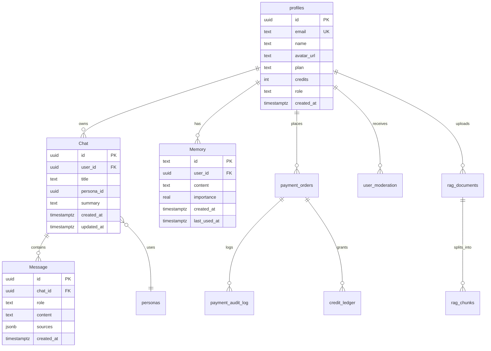
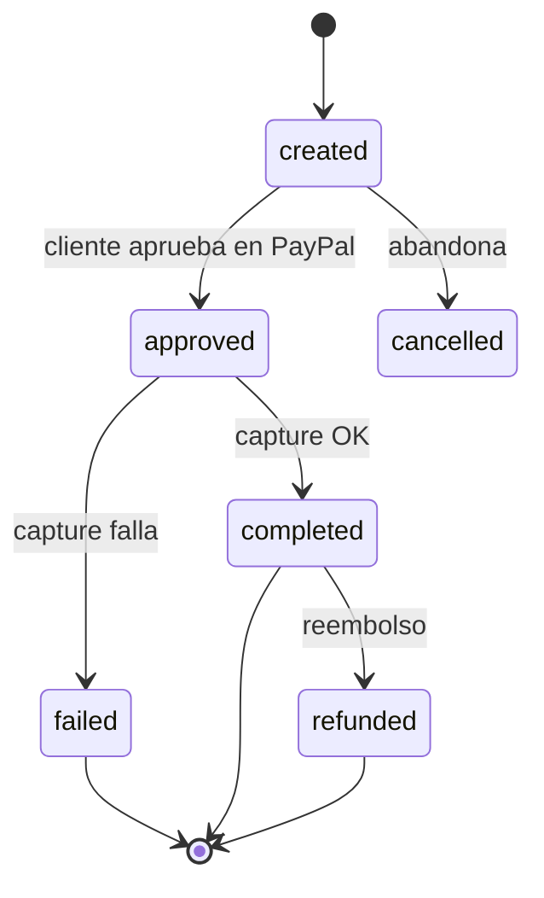

# Esquema de Base de Datos

> **Motor:** PostgreSQL 15+ (Supabase) · **Extensiones:** `vector`, `pgcrypto`
> **Fuente de verdad:** `migrations/` + DDL preexistente en Supabase.

---

## 1. Advertencia fundamental

Este repositorio **no contiene** el DDL de las tablas base. Las migraciones versionadas sólo aplican cambios incrementales sobre un esquema que ya existe en Supabase.

| Tabla | ¿DDL en el repo? | Nombres |
|---|---|---|
| `profiles` | ❌ | minúsculas |
| `"Chat"` | ❌ | **PascalCase, requiere comillas** |
| `"Message"` | ❌ | **PascalCase** |
| `"Memory"` | ❌ | **PascalCase** |
| `rag_documents`, `rag_chunks` | ⚠️ parcial | minúsculas |
| `payment_*` | ✅ | minúsculas |
| `user_moderation` | ✅ | minúsculas |
| `_migrations` | ✅ (runtime) | minúsculas |

> 🚨 PostgreSQL pliega a minúsculas todo identificador sin comillas. `SELECT * FROM "Message"` es distinto de `SELECT * FROM message`. El runtime usa comillas; la migración `001` no. Ese es el defecto #1 del proyecto.

---

## 2. Diagrama entidad-relación (núcleo)



---

## 3. `profiles`

Cuenta de usuario. Es la tabla raíz de casi todo.

```sql
-- DDL de referencia (preexistente en Supabase)
create table if not exists profiles (
  id            uuid primary key default gen_random_uuid(),
  email         text not null unique,
  name          text,
  avatar_url    text,
  password_hash text,                      -- null si sólo OAuth
  provider      text default 'email',      -- 'email' | 'google' | 'github'
  plan          text not null default 'free',
  credits       integer not null default 0,
  role          text not null default 'user',
  email_verified boolean not null default false,
  created_at    timestamptz not null default now(),
  updated_at    timestamptz not null default now()
);

create index if not exists idx_profiles_email on profiles (lower(email));
create index if not exists idx_profiles_plan  on profiles (plan);
```

| Columna | Tipo | Null | Default | Notas |
|---|---|---|---|---|
| `id` | `uuid` | No | `gen_random_uuid()` | PK; coincide con `auth.users.id` de Supabase si se usa Auth |
| `email` | `text` | No | — | Único; se compara en minúsculas |
| `name` | `text` | Sí | — | Nombre visible |
| `avatar_url` | `text` | Sí | — | URL externa |
| `password_hash` | `text` | Sí | — | bcrypt; null para OAuth puro |
| `provider` | `text` | Sí | `email` | Origen de la cuenta |
| `plan` | `text` | No | `free` | `free` \| `pro` \| `ultimate` |
| `credits` | `integer` | No | `0` | Saldo actual; **nunca negativo** |
| `role` | `text` | No | `user` | `user` \| `admin` |
| `email_verified` | `boolean` | No | `false` | |
| `created_at` | `timestamptz` | No | `now()` | UTC |
| `updated_at` | `timestamptz` | No | `now()` | Actualizado por trigger o por el servicio |

### Invariantes

- `credits >= 0`: se garantiza en la query de débito (`WHERE credits >= $1`).
- `plan ∈ {free, pro, ultimate}`: validado en Zod y en `PLAN_CATALOG`.
- `email` siempre `lower()` al insertar y al buscar.

---

## 4. `"Chat"`

```sql
create table if not exists "Chat" (
  id          uuid primary key default gen_random_uuid(),
  user_id     uuid not null references profiles(id) on delete cascade,
  title       text not null default 'Nuevo chat',
  persona_id  uuid references personas(id) on delete set null,
  summary     text,
  model       text,
  created_at  timestamptz not null default now(),
  updated_at  timestamptz not null default now()
);

create index if not exists idx_chat_user_updated
  on "Chat" (user_id, updated_at desc);
```

| Columna | Tipo | Notas |
|---|---|---|
| `id` | `uuid` | PK |
| `user_id` | `uuid` | FK → `profiles.id`, `on delete cascade` |
| `title` | `text` | Generado de los primeros ~60 chars del primer mensaje |
| `persona_id` | `uuid` | FK opcional a `personas` |
| `summary` | `text` | Resumen rolling para contexto largo |
| `model` | `text` | Último modelo usado (informativo) |
| `updated_at` | `timestamptz` | Se toca en cada mensaje nuevo |

### Por qué PascalCase

Viene del cliente Supabase original (tablas creadas desde el dashboard con esos nombres). Cambiarlo ahora requiere migración con rename y actualizar ~40 queries. Se documenta y se convive.

---

## 5. `"Message"`

```sql
create table if not exists "Message" (
  id         uuid primary key default gen_random_uuid(),
  chat_id    uuid not null references "Chat"(id) on delete cascade,
  role       text not null check (role in ('user','assistant','system','tool')),
  content    text not null,
  sources    jsonb default '[]'::jsonb,
  tokens     integer,
  status     text default 'complete',   -- 'complete' | 'partial' | 'error'
  created_at timestamptz not null default now()
);

create index if not exists idx_message_chat_created
  on "Message" (chat_id, created_at asc);
```

| Columna | Tipo | Notas |
|---|---|---|
| `role` | `text` | `user`, `assistant`, `system`, `tool` |
| `content` | `text` | Markdown crudo |
| `sources` | `jsonb` | Array de `{title,url,snippet}` para citas RAG/web |
| `status` | `text` | `partial` si el stream se cortó |

### Limitación conocida

**No existe columna `provider`.** No se puede saber qué motor generó cada respuesta. Se propone añadirla en Fase 2:

```sql
alter table "Message" add column if not exists provider text;
alter table "Message" add column if not exists model text;
```

### Migración 001 — el desajuste

```sql
-- migrations/001_add_sources_to_messages.sql (real)
alter table messages add column if not exists sources jsonb default '[]'::jsonb;
```

Apunta a `messages` en minúsculas. En una DB donde sólo existe `"Message"`, esta migración falla con `relation "messages" does not exist`. Opciones:

1. Corregir a `"Message"` (recomendado).
2. Crear una vista `messages` sobre `"Message"` (parche).

---

## 6. `"Memory"` y memoria de largo plazo

### Tabla clásica

```sql
create table if not exists "Memory" (
  id           text primary key,              -- 'mem_<base36>'
  user_id      uuid not null references profiles(id) on delete cascade,
  content      text not null,
  importance   real not null default 0.5,
  tags         text[] default '{}',
  created_at   timestamptz not null default now(),
  last_used_at timestamptz
);

create index if not exists idx_memory_user on "Memory" (user_id);
```

| Detalle | Valor |
|---|---|
| `id` | **TEXT**, no UUID. Formato `mem_` + base36 |
| `importance` | 0.0–1.0, usado para ranking y decay |
| `tags` | Array de texto para filtrado |

### Tabla de largo plazo

`migrations/2026_10_13_long_term_memory.sql` introduce el modelo vectorial:

```sql
create table if not exists long_term_memories (
  id           uuid primary key default gen_random_uuid(),
  user_id      uuid not null references profiles(id) on delete cascade,
  content      text not null,
  embedding    vector(1536),
  importance   real not null default 0.5,
  half_life    integer not null default 60,
  last_used_at timestamptz default now(),
  created_at   timestamptz not null default now()
);

create or replace function match_memories(
  query_embedding vector(1536),
  match_user uuid,
  match_count int default 6,
  min_importance real default 0.05
)
returns table (id uuid, content text, similarity float, importance real)
language sql stable as $$
  select m.id,
         m.content,
         1 - (m.embedding <=> query_embedding) as similarity,
         m.importance
  from long_term_memories m
  where m.user_id = match_user
    and m.importance >= min_importance
    and m.embedding is not null
  order by m.embedding <=> query_embedding
  limit match_count;
$$;
```

| Parámetro | Valor | Significado |
|---|---|---|
| `halfLifeDays` | 60 | La importancia se reduce a la mitad cada 60 días sin uso |
| `minImportance` | 0.05 | Por debajo, la memoria se ignora (y puede purgarse) |
| `topK` | 6 | Memorias inyectadas al prompt |
| `embeddingDim` | 1536 | Coincide con el modelo de embeddings |

### Fórmula de decay

```text
importancia_efectiva = importance * 0.5 ^ (días_sin_uso / 60)
```

Implementada en `src/services/long-term-memory.js`. Se recalcula al leer, no se persiste en cada request (evita writes innecesarios).

---

## 7. RAG

```sql
create table if not exists rag_documents (
  id           uuid primary key default gen_random_uuid(),
  user_id      uuid not null references profiles(id) on delete cascade,
  filename     text not null,
  mime_type    text,
  size_bytes   bigint,
  status       text default 'pending',   -- pending | indexing | ready | failed
  chunk_count  integer default 0,
  created_at   timestamptz not null default now()
);

create table if not exists rag_chunks (
  id              uuid primary key default gen_random_uuid(),
  document_id     uuid not null references rag_documents(id) on delete cascade,
  user_id         uuid not null,
  content         text not null,
  embedding       vector(1536),
  embedding_model text,
  chunk_index     integer not null,
  token_count     integer,
  created_at      timestamptz not null default now()
);

create index if not exists idx_rag_chunks_doc on rag_chunks (document_id);

-- ⚠️ FALTA: índice vectorial
-- create index idx_rag_chunks_embedding on rag_chunks
--   using hnsw (embedding vector_cosine_ops);
```

### Parámetros de chunking

| Parámetro | Valor | Efecto |
|---|---|---|
| `chunkSize` | 1 000 chars | Tamaño objetivo |
| `chunkOverlap` | 180 chars | Continuidad entre chunks |
| `minChunkChars` | 60 | Descarta fragmentos basura |
| `embeddingDim` | 1 536 | Dimensión del vector |
| `topK` | 6 | Chunks recuperados por query |

### El problema del índice ausente

Sin índice `hnsw` ni `ivfflat`, cada búsqueda hace un **sequential scan** sobre todos los chunks del usuario. Con 10 000 chunks y 1 536 dims, eso son ~60 MB leídos por query.

```sql
-- Recomendado cuando haya > 5 000 chunks
create index concurrently idx_rag_chunks_embedding
  on rag_chunks using hnsw (embedding vector_cosine_ops)
  with (m = 16, ef_construction = 64);

set hnsw.ef_search = 40;
```

> Los comentarios del archivo mencionan `ivfflat`, pero la creación está comentada. Ver [`troubleshooting.md`](./troubleshooting.md#rag-lento).

---

## 8. Personas

```sql
create table if not exists personas (
  id            uuid primary key default gen_random_uuid(),
  user_id       uuid references profiles(id) on delete cascade,
  name          text not null,
  description   text,
  system_prompt text not null,
  temperature   real default 0.7,
  color         text default '#6366f1',
  avatar_url    text,
  is_public     boolean default false,
  created_at    timestamptz not null default now()
);

create index if not exists idx_personas_user on personas (user_id);
```

| Restricción | Regla |
|---|---|
| `temperature` | 0.0 – 2.0 |
| `system_prompt` | 1 – 8 000 chars |
| `is_public` | Sólo admin puede publicar globales (`user_id IS NULL`) |

---

## 9. Pagos

```sql
create table if not exists payment_orders (
  id                uuid primary key default gen_random_uuid(),
  user_id           uuid not null references profiles(id) on delete cascade,
  paypal_order_id   text unique,
  paypal_capture_id text,
  plan_id           text not null,
  amount_usd        numeric(10,2) not null,
  currency          text not null default 'USD',
  status            text not null default 'created',
  credits_granted   integer not null default 0,
  created_at        timestamptz not null default now(),
  completed_at      timestamptz
);

create index if not exists idx_orders_user on payment_orders (user_id, created_at desc);

create table if not exists payment_idempotency (
  key         text primary key,
  response    jsonb,
  created_at  timestamptz not null default now()
);

create table if not exists payment_audit_log (
  id         bigserial primary key,
  user_id    uuid,
  order_id   uuid,
  action     text not null,
  metadata   jsonb,
  ip         inet,
  created_at timestamptz not null default now()
);

create table if not exists credit_ledger (
  id         bigserial primary key,
  user_id    uuid not null,
  delta      integer not null,
  reason     text not null,
  order_id   uuid,
  created_at timestamptz not null default now()
);
```

| Tabla | Propósito | Retención |
|---|---|---|
| `payment_orders` | Estado de cada compra | Permanente |
| `payment_idempotency` | Evitar doble create/capture | TTL 10–60 s (se limpia por edad) |
| `payment_audit_log` | Evidencia legal | ≥ 5 años |
| `credit_ledger` | Libro mayor de créditos | Permanente |

### Invariantes de dinero

```sql
-- Nunca doble crédito por la misma orden
create unique index if not exists uq_ledger_order_reason
  on credit_ledger (order_id, reason)
  where order_id is not null;
```

### `status` de una orden



---

## 10. Moderación

```sql
create table if not exists user_moderation (
  user_id         uuid primary key references profiles(id) on delete cascade,
  strikes         integer not null default 0,
  risk_score      integer not null default 0,
  suspended_until timestamptz,
  last_reason     text,
  updated_at      timestamptz not null default now()
);
```

| Umbral | Acción |
|---|---|
| `risk_score >= 80` | Suspensión inmediata 24 h |
| `strikes >= 2` | Advertencia formal |
| `strikes >= 3` | Suspensión 24 h y revisión manual |

---

## 11. Sesiones y migraciones

```sql
create table if not exists revoked_sessions (
  jti         text primary key,
  user_id     uuid not null,
  revoked_at  timestamptz not null default now(),
  expires_at  timestamptz not null
);

create table if not exists _migrations (
  name        text primary key,
  applied_at  timestamptz not null default now()
);
```

`revoked_sessions` implementa logout real: el JWT sigue siendo válido criptográficamente, pero el middleware consulta esta tabla y lo rechaza. Se limpia por `expires_at < now()`.

---

## 12. Otras tablas operativas

| Tabla | Uso |
|---|---|
| `notifications` | Bandeja in-app (`read_at`, `type`, `payload`) |
| `feature_flags` | `key`, `enabled`, `rollout_pct`, `audience` |
| `webhook_endpoints` | Webhooks salientes del usuario |
| `webhook_deliveries` | Intentos, status, respuesta |
| `prompts` | Biblioteca pública/privada |
| `projects` | Agrupación de archivos del modo Coder |
| `project_files` | Contenido de archivos (`path`, `content`, `updated_at`) |
| `api_keys` | Claves de API de usuario (hash, no texto plano) |
| `usage_events` | Telemetría de consumo |

---

## 13. Row Level Security

Supabase habilita RLS por defecto. El backend usa la **service role key**, que **bypasea RLS**. Eso significa: la seguridad multi-tenant depende del código (`WHERE user_id = $1`), no de Postgres.

| Tabla | RLS | Política recomendada |
|---|---|---|
| `profiles` | ✅ | `auth.uid() = id` |
| `"Chat"` | ✅ | `auth.uid() = user_id` |
| `"Message"` | ✅ | vía join con `"Chat"` |
| `"Memory"` | ✅ | `auth.uid() = user_id` |
| `rag_chunks` | ✅ | `auth.uid() = user_id` |
| `payment_*` | ✅ | sin acceso cliente |
| `_migrations` | ✅ | sin acceso cliente |

```sql
alter table "Chat" enable row level security;

create policy chat_owner on "Chat"
  for all using (auth.uid() = user_id)
  with check (auth.uid() = user_id);
```

> Si en algún momento se expone la `anon key` al cliente, RLS es la única barrera. Verifícala antes de hacerlo.

---

## 14. Consultas de diagnóstico

```sql
-- Tamaño por tabla
select relname,
       pg_size_pretty(pg_total_relation_size(c.oid)) as total
from pg_class c
join pg_namespace n on n.oid = c.relnamespace
where n.nspname = 'public' and c.relkind = 'r'
order by pg_total_relation_size(c.oid) desc
limit 20;

-- Índices de una tabla
select indexname, indexdef from pg_indexes
where tablename = 'rag_chunks';

-- Chunks sin embedding
select count(*) from rag_chunks where embedding is null;

-- Órdenes sin crédito otorgado
select id, user_id, status, credits_granted, created_at
from payment_orders
where status = 'completed' and credits_granted = 0;

-- Usuarios cerca del límite de suspensión
select user_id, strikes, risk_score, suspended_until
from user_moderation
where strikes >= 2 or risk_score >= 60;

-- Migraciones aplicadas
select name, applied_at from _migrations order by applied_at;
```

---

## 15. Backup y restauración

```bash
# Dump completo (Supabase → local)
pg_dump "$DATABASE_URL" --no-owner --no-acl -Fc -f numination.dump

# Restaurar
pg_restore --no-owner --no-acl -d "$TARGET_URL" numination.dump

# Sólo esquema
pg_dump "$DATABASE_URL" --schema-only -f schema.sql
```

| Frecuencia | Tipo | Retención |
|---|---|---|
| Diaria | Snapshot automático Supabase | 7 días (plan gratuito) |
| Semanal | `pg_dump` a almacenamiento externo | 90 días |
| Antes de migración | Dump manual | Hasta validación |

> Prueba la restauración al menos una vez por trimestre. Un backup que nunca se restauró no es un backup.

---

## 16. Checklist antes de una migración

- [ ] Dump reciente verificado
- [ ] Migración es idempotente (`if not exists`)
- [ ] Nombres de tabla coinciden con el runtime (comillas incluidas)
- [ ] No hay `DROP` sin respaldo
- [ ] Índices creados con `concurrently` en tablas grandes
- [ ] Probada en una rama de Supabase
- [ ] Plan de rollback escrito
- [ ] Registrada en `_migrations` al aplicarse

*Siguiente: [`memory-system.md`](./memory-system.md) para el detalle de RAG y memoria.*
