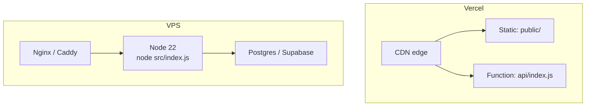

# Despliegue

> **Plataformas soportadas:** Vercel (producción actual), Node 22 en VPS/Docker, Railway.
> **Archivo de configuración:** `vercel.json`.

---

## 1. Topologías



| Criterio | Vercel | VPS |
|---|---|---|
| Costo inicial | Bajo / gratis | ~USD 5–20/mes |
| SSE largo | Limitado por timeout | Sin límite práctico |
| Estáticos | CDN global | Nginx |
| Procesos background | ❌ | ✅ |
| Cold start | Sí | No |
| Escalado | Automático | Manual |
| Complejidad | Mínima | Media |

**Recomendación actual:** Vercel para producción web, VPS si se añaden workers, cron o colas.

---

## 2. Despliegue en Vercel

### 2.1 `vercel.json`

```json
{
  "cleanUrls": true,
  "outputDirectory": "public",
  "rewrites": [{ "source": "/api/(.*)", "destination": "/api" }]
}
```

| Clave | Efecto |
|---|---|
| `cleanUrls` | `/chat.html` → `/chat` |
| `outputDirectory` | Sirve `public/` como raíz estática |
| `rewrites` | Todo `/api/*` cae en la función única `api/index.js` |

### 2.2 `api/index.js`

```js
import app from '../src/index.js';

export default function handler(req, res) {
  return app(req, res);
}
```

También puede exportarse `app` directamente. Express 5 es compatible con la firma `(req, res)` de Vercel.

### 2.3 Variables en Vercel

Project → Settings → Environment Variables. Añadir todas las de [`installation.md`](./installation.md) con valores de producción.

| Variable | Producción |
|---|---|
| `NODE_ENV` | `production` |
| `APP_URL` | `https://numination.app` |
| `JWT_SECRET` | 64+ bytes, distinto del de dev |
| `DATABASE_URL` | Pooler de Supabase (6543) |
| `PAYPAL_MODE` | `live` |
| `CORS_ORIGINS` | dominios de producción |

> `VERCEL=1` lo inyecta la plataforma. El código lo usa para omitir `listen` y `static`. No lo definas manualmente.

### 2.4 Dominios

1. Vercel → Domains → añadir `numination.app`.
2. En el registrador: `A` a `76.76.21.21` o `CNAME` a `cname.vercel-dns.com`.
3. `www` → redirección a apex.
4. Verificar emisión de certificado (automático).

### 2.5 Deploy

```bash
vercel --prod
```

O por Git: push a `main` → deploy automático.

---

## 3. Despliegue en VPS

### 3.1 Requisitos

| Recurso | Mínimo | Recomendado |
|---|---|---|
| CPU | 1 vCPU | 2 vCPU |
| RAM | 1 GB | 2 GB |
| Disco | 10 GB | 25 GB |
| SO | Ubuntu 22.04 | Ubuntu 24.04 |

### 3.2 Instalación

```bash
# Node 22
curl -fsSL https://deb.nodesource.com/setup_22.x | sudo -E bash -
sudo apt install -y nodejs postgresql-client nginx

# App
sudo mkdir -p /opt/numination && sudo chown $USER /opt/numination
git clone <repo> /opt/numination
cd /opt/numination
npm ci --omit=dev
```

### 3.3 Variables

```bash
sudo nano /opt/numination/.env
```

```dotenv
NODE_ENV=production
PORT=8080
APP_URL=https://numination.app
DATABASE_URL=postgresql://...
JWT_SECRET=...
```

```bash
sudo chmod 600 /opt/numination/.env
```

### 3.4 systemd

```ini
# /etc/systemd/system/numination.service
[Unit]
Description=Numination
After=network.target

[Service]
Type=simple
User=numination
WorkingDirectory=/opt/numination
ExecStart=/usr/bin/node src/index.js
Restart=always
RestartSec=5
EnvironmentFile=/opt/numination/.env
StandardOutput=journal
StandardError=journal
NoNewPrivileges=true
PrivateTmp=true

[Install]
WantedBy=multi-user.target
```

```bash
sudo systemctl daemon-reload
sudo systemctl enable --now numination
sudo journalctl -u numination -f
```

### 3.5 Nginx

```nginx
server {
    listen 443 ssl http2;
    server_name numination.app;

    ssl_certificate     /etc/letsencrypt/live/numination.app/fullchain.pem;
    ssl_certificate_key /etc/letsencrypt/live/numination.app/privkey.pem;

    client_max_body_size 12m;

    location /api/chat/stream {
        proxy_pass http://127.0.0.1:8080;
        proxy_http_version 1.1;
        proxy_set_header Connection '';
        proxy_buffering off;
        proxy_cache off;
        proxy_read_timeout 120s;
        chunked_transfer_encoding off;
    }

    location / {
        proxy_pass http://127.0.0.1:8080;
        proxy_set_header Host $host;
        proxy_set_header X-Real-IP $remote_addr;
        proxy_set_header X-Forwarded-For $proxy_add_x_forwarded_for;
        proxy_set_header X-Forwarded-Proto $scheme;
        proxy_read_timeout 60s;
    }
}

server {
    listen 80;
    server_name numination.app;
    return 301 https://$host$request_uri;
}
```

**Lo crítico para SSE:** `proxy_buffering off` y `proxy_read_timeout` mayor que el timeout del stream. Sin eso, Nginx acumula los tokens y el usuario ve la respuesta de golpe al final.

### 3.6 TLS

```bash
sudo apt install -y certbot python3-certbot-nginx
sudo certbot --nginx -d numination.app -d www.numination.app
sudo certbot renew --dry-run
```

---

## 4. Docker

`Dockerfile`:

```dockerfile
FROM node:22-alpine AS base
WORKDIR /app
ENV NODE_ENV=production

COPY package*.json ./
RUN npm ci --omit=dev && npm cache clean --force

COPY src ./src
COPY services ./services
COPY public ./public
COPY migrations ./migrations
COPY scripts ./scripts

USER node
EXPOSE 8080
HEALTHCHECK --interval=30s --timeout=5s --retries=3 \
  CMD node -e "fetch('http://127.0.0.1:8080/api/health').then(r=>process.exit(r.ok?0:1)).catch(()=>process.exit(1))"

CMD ["node", "src/index.js"]
```

`docker-compose.yml`:

```yaml
services:
  app:
    build: .
    ports: ["8080:8080"]
    env_file: .env
    restart: unless-stopped
    depends_on:
      db:
        condition: service_healthy
  db:
    image: pgvector/pgvector:pg16
    environment:
      POSTGRES_PASSWORD: postgres
      POSTGRES_DB: numination
    volumes:
      - pgdata:/var/lib/postgresql/data
    healthcheck:
      test: ["CMD-SHELL", "pg_isready -U postgres"]
      interval: 5s
      retries: 10
volumes:
  pgdata:
```

```bash
docker compose up -d --build
docker compose logs -f app
```

> No metas `.env` en la imagen. Usa `env_file` o secretos del orquestador.

---

## 5. Migraciones en el deploy

### Opción A — Manual antes del deploy

```bash
DATABASE_URL=... npm run migrate
```

### Opción B — Paso en CI

```yaml
- run: npm ci
- run: npm test
- run: npm run migrate
  env:
    DATABASE_URL: ${{ secrets.DATABASE_URL }}
- run: vercel deploy --prod --token=${{ secrets.VERCEL_TOKEN }}
```

### Reglas

1. Las migraciones deben ser **idempotentes** (`if not exists`).
2. Nunca elimines una columna en el mismo deploy que deja de usarla.
3. Backfill en un deploy separado del cambio de código.
4. Si hay downtime aceptable, migra antes; si no, migración compatible hacia atrás.

---

## 6. CI/CD

`.github/workflows/ci.yml`:

```yaml
name: CI

on:
  push:
    branches: [main]
  pull_request:

jobs:
  test:
    runs-on: ubuntu-latest
    steps:
      - uses: actions/checkout@v4
      - uses: actions/setup-node@v4
        with:
          node-version: 22
          cache: npm
      - run: npm ci
      - run: npm run lint --if-present
      - run: npm test
        env:
          NODE_ENV: test
          DATABASE_URL: ${{ secrets.TEST_DATABASE_URL }}
          JWT_SECRET: test-secret-not-for-production
      - run: npm audit --omit=dev
```

### Reglas de merge

| Regla | Motivo |
|---|---|
| CI verde | Evitar romper main |
| 1 review | Calidad |
| Sin secretos en el diff | Seguridad |
| Migraciones revisadas | Datos |

---

## 7. Healthchecks y monitoreo

### Endpoint

```bash
curl -fsS https://numination.app/api/health
```

Respuesta:

```json
{ "ok": true, "status": "healthy", "db": "up", "uptime": 3821.2 }
```

### Qué monitorear

| Señal | Umbral de alerta |
|---|---|
| `/api/health` no responde | 2 fallos seguidos |
| `db: "down"` | 1 vez |
| Latencia p95 | > 3 s |
| Tasa de 5xx | > 2 % en 5 min |
| `ALL_PROVIDERS_FAILED` | > 5 en 5 min |
| Cola de webhooks fallidos | > 20 |

### Uptime externo

Configura un monitor (BetterStack, UptimeRobot) contra `/api/health` cada 60 s desde dos regiones.

---

## 8. Rollback

### Vercel

1. Deployments → seleccionar el anterior → **Promote to Production**.
2. Instantáneo, sin rebuild.

### VPS

```bash
cd /opt/numination
git log --oneline -5
git checkout <commit-anterior>
npm ci --omit=dev
sudo systemctl restart numination
```

| Escenario | Acción |
|---|---|
| Bug de código | Rollback de commit |
| Migración destructiva | Restaurar dump |
| Proveedor caído | Cambiar cadena en `config.js` |
| Clave comprometida | Rotar y reiniciar |

> Antes de cualquier rollback, verifica si la migración nueva es incompatible con el código anterior. Si lo es, el rollback requiere restaurar la DB también.

---

## 9. Backup

| Qué | Cómo | Frecuencia |
|---|---|---|
| Base de datos | `pg_dump -Fc` | Diaria |
| Código | Git | Continuo |
| Variables | Gestor de secretos | Al cambiar |
| Archivos subidos | Supabase Storage | Automático |

```bash
pg_dump "$DATABASE_URL" --no-owner --no-acl -Fc \
  -f "backup-$(date +%Y%m%d).dump"
```

Verifica la restauración mensualmente en una DB desechable.

---

## 10. Límites de Vercel que afectan el diseño

| Límite | Valor (plan actual) | Impacto |
|---|---|---|
| Duración de función | 10–60 s según plan | SSE largo se corta |
| Tamaño de payload | 4.5 MB | Subidas grandes deben ir directo a Storage |
| Memoria | 1–3 GB | PDFs enormes pueden agotarla |
| Ejecuciones concurrentes | Limitado | Picos de chat |
| Sin background | — | Workers y cron no corren |

### Mitigaciones implementadas

- Heartbeat SSE cada 15 s.
- Timeout de stream de 90 s con cierre limpio.
- Subida de archivos con límite de 10 MB.
- Parseo de PDF con corte por tamaño.

### Mitigaciones pendientes

- Subida directa a Supabase Storage con URL firmada.
- Cola externa para indexación.
- Cron externo para purgas.

---

## 11. Checklist de producción

### Antes del primer deploy

- [ ] `NODE_ENV=production`
- [ ] `JWT_SECRET` aleatorio y distinto al de dev
- [ ] `DATABASE_URL` con SSL
- [ ] Migraciones aplicadas
- [ ] `PAYPAL_MODE=live` y credenciales live
- [ ] Webhook registrado con la URL final
- [ ] `APP_URL` con HTTPS
- [ ] CORS sólo con dominios reales
- [ ] `node_modules` no versionado
- [ ] `.env` no versionado
- [ ] Logs sin datos personales

### Después del deploy

- [ ] `/api/health` → 200
- [ ] `/api/version` → 3.3.0
- [ ] Registro y login funcionan
- [ ] OAuth redirige bien (Google y GitHub)
- [ ] Chat responde con streaming
- [ ] SSE no se corta a los 30 s
- [ ] Subida de PDF indexa
- [ ] Pago sandbox → live con monto mínimo
- [ ] Webhook recibe y acredita
- [ ] Panel admin accesible sólo con rol admin
- [ ] `www` redirige a apex
- [ ] Certificado válido
- [ ] No hay errores en consola del navegador

---

## 12. Costos estimados

| Servicio | Plan | USD/mes |
|---|---|---|
| Vercel | Hobby / Pro | 0 / 20 |
| Supabase | Free / Pro | 0 / 25 |
| Groq | Pay as you go | ~5–30 |
| Gemini | Free tier + pago | 0–20 |
| PayPal | 3.49 % + 0.49 por transacción | variable |
| Brevo | Free 300 emails/día | 0 |
| Dominio | Anual | ~1 |
| **Total base** | | **~6–100** |

A 1 000 usuarios activos con uso moderado, el costo dominante suele ser el de tokens, no la infraestructura.

---

## 13. Incidentes de despliegue comunes

| Síntoma | Causa probable | Solución |
|---|---|---|
| 500 en todas las rutas | Falta `DATABASE_URL` | Revisar env |
| `FUNCTION_INVOCATION_TIMEOUT` | Stream > límite | Reducir timeout o mover a VPS |
| Estáticos 404 | `outputDirectory` mal | Verificar `public/` |
| `/api/*` 404 | Rewrite ausente | Revisar `vercel.json` |
| Login redirige mal | `APP_URL` incorrecta | Corregir y redeploy |
| Webhook 401 | `rawBody` ausente o secreto mal | Revisar orden de middleware |
| CORS error | Origen no allowlisted | Añadir dominio |
| SSE llega en bloque | Buffering del proxy | `proxy_buffering off` |
| Cold start de 5 s | Función grande | Reducir dependencias |

---

## 14. Escalar

### Vertical

Más memoria/CPU en la función o el VPS. Útil si el cuello es parseo de PDFs.

### Horizontal

| Componente | Cómo |
|---|---|
| HTTP | Más instancias (Vercel lo hace solo) |
| DB | Connection pooler (Supabase) + índices |
| IA | Más keys / proveedores |
| Sesiones | Ya en DB, no en memoria |
| Caché | Mover a Redis si se necesita compartir |

### Qué **no** escala hoy

- Caché en memoria (`src/lib/cache.js`) por instancia.
- Cooldown de keys de Gemini por proceso.
- Rate limit en memoria (se reinicia en cold start).

Para producción de alto volumen, los tres deben moverse a Redis o Postgres.

---

*Siguiente: [`frontend-guide.md`](./frontend-guide.md) y [`troubleshooting.md`](./troubleshooting.md).*
