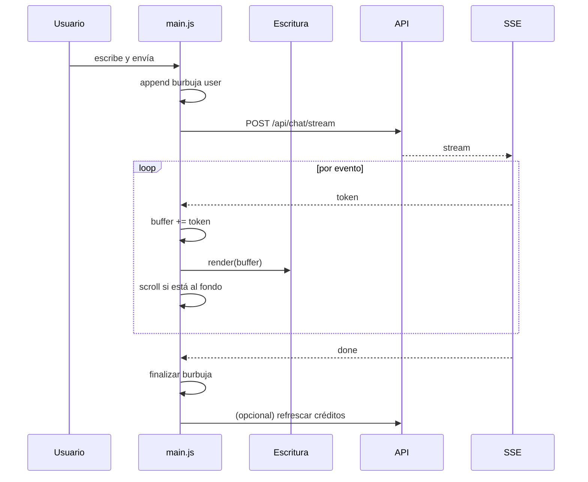

# Guía del Frontend

> **Stack:** HTML5 + CSS3 + JavaScript vanilla (ES2022). **Sin bundler, sin framework, sin build step.**
> **Archivos principales:** `public/assets/js/main.js` (2 034 LOC), `coder.js` (1 973 LOC), `escritura.js` (677 LOC).

---

## 1. Filosofía

| Decisión | Razón |
|---|---|
| Sin React/Vue | Cero build, carga instantánea, menos superficie de ataque |
| Sin bundler | Lo que se escribe es lo que se sirve |
| Globals (`window.X`) | Scripts clásicos, sin `import`/`export` |
| CSS plano | Sin preprocesador, sin purga |
| Progresivo | Funciona sin JS para contenido estático |

El costo es disciplina: sin tipos, sin árbol de dependencias, sin hot reload. Se compensa con módulos IIFE pequeños y contratos claros.

---

## 2. Estructura

```text
public/
├── index.html          # landing / entrada
├── chat.html           # aplicación de chat
├── coder.html          # IDE
├── login.html
├── register.html
├── admin.html
├── pricing.html
├── pago-exito.html
├── pago-cancelado.html
├── assets/
│   ├── css/
│   │   ├── base.css
│   │   ├── layout.css
│   │   ├── components.css
│   │   ├── chat.css
│   │   ├── coder.css
│   │   └── responsive.css
│   ├── js/
│   │   ├── main.js
│   │   ├── escritura.js
│   │   ├── coder.js
│   │   ├── api.js
│   │   ├── auth.js
│   │   ├── admin.js
│   │   ├── ui.js
│   │   └── utils.js
│   └── img/
└── favicon.ico
```

### Orden de carga

```html
<script src="/assets/js/utils.js" defer></script>
<script src="/assets/js/escritura.js" defer></script>
<script src="/assets/js/api.js" defer></script>
<script src="/assets/js/ui.js" defer></script>
<script src="/assets/js/main.js" defer></script>
```

`defer` garantiza orden de ejecución y no bloquea el parseo. **No** usar `async` en scripts que dependen entre sí.

---

## 3. Módulos globales

### 3.1 `window.Escritura`

Motor de render Markdown.

```js
window.Escritura = (function () {
  let styleInjected = false;

  function injectStyles() {
    if (styleInjected) return;
    const style = document.createElement('style');
    style.textContent = `.md h1{...} .md code{...}`;
    document.head.appendChild(style);
    styleInjected = true;
  }

  function escapeHTML(s) { /* ... */ }
  function sanitizeURL(u) { /* ... */ }
  function highlight(code, lang) { /* ... */ }
  function render(markdown) { /* ... */ }

  return { render, escapeHTML, sanitizeURL, highlight };
})();
```

| Método | Entrada | Salida |
|---|---|---|
| `render(md)` | Markdown | HTML seguro |
| `escapeHTML(s)` | texto | entidades escapadas |
| `sanitizeURL(u)` | URL | URL segura o `#` |
| `highlight(code, lang)` | código | HTML con `<span>` |

#### El `<style>` inyectado

`escritura.js` crea un `<style>` en `document.head` la primera vez que se usa (alrededor de la línea 447). Es funcional pero obliga a `style-src 'unsafe-inline'` en la CSP.

**Deuda técnica:** mover esas reglas a `assets/css/markdown.css` permitiría endurecer la CSP. Requiere cargar la hoja en todas las páginas que usan el motor.

### 3.2 `window.API`

Wrapper de `fetch` con cookies y manejo de errores.

```js
window.API = {
  async get(path) {
    const res = await fetch(path, { credentials: 'include' });
    return handle(res);
  },
  async post(path, body) {
    const res = await fetch(path, {
      method: 'POST',
      headers: { 'Content-Type': 'application/json' },
      credentials: 'include',
      body: JSON.stringify(body)
    });
    return handle(res);
  }
};

async function handle(res) {
  let json = null;
  try { json = await res.json(); } catch {}
  if (!res.ok) {
    const err = new Error(json?.error || `HTTP ${res.status}`);
    err.code = json?.code;
    err.status = res.status;
    throw err;
  }
  return json;
}
```

| Regla | Detalle |
|---|---|
| `credentials: 'include'` | Sin esto, la cookie no viaja |
| Parseo tolerante | Algunas respuestas no son JSON |
| Error tipado | `err.code` permite mensajes específicos |
| Sin reintentos automáticos | Los decide la capa de UI |

### 3.3 `window.UI`

| Función | Uso |
|---|---|
| `toast(msg, type)` | Notificación efímera |
| `modal.open(id)` / `.close()` | Diálogos |
| `confirm(msg)` | Confirmación con promesa |
| `loader.show()` / `.hide()` | Spinner global |
| `formatDate(iso)` | Fecha local |

### 3.4 `window.Auth`

| Función | Uso |
|---|---|
| `Auth.me()` | Carga `/api/me` |
| `Auth.require()` | Redirige a login si 401 |
| `Auth.logout()` | POST logout + redirección |
| `Auth.user` | Usuario cacheado |

---

## 4. Flujo del chat



### Lectura del stream

```js
async function streamChat(payload, onToken, onDone, onError) {
  const controller = new AbortController();
  const res = await fetch('/api/chat/stream', {
    method: 'POST',
    headers: { 'Content-Type': 'application/json' },
    body: JSON.stringify(payload),
    credentials: 'include',
    signal: controller.signal
  });

  if (!res.ok) return onError(new Error(`HTTP ${res.status}`));

  const reader = res.body.getReader();
  const decoder = new TextDecoder();
  let buf = '';

  while (true) {
    const { done, value } = await reader.read();
    if (done) break;
    buf += decoder.decode(value, { stream: true });

    const blocks = buf.split('\n\n');
    buf = blocks.pop() ?? '';

    for (const block of blocks) {
      const event = /^event: (.+)$/m.exec(block)?.[1];
      const dataLine = /^data: (.+)$/m.exec(block)?.[1];
      if (!dataLine) continue;
      const data = JSON.parse(dataLine);

      if (event === 'token') onToken(data.t);
      else if (event === 'done') onDone(data);
      else if (event === 'error') onError(Object.assign(new Error(data.message), data));
    }
  }
}
```

### Detalles que importan

| Detalle | Por qué |
|---|---|
| `TextDecoder({ stream: true })` | Evita cortar caracteres UTF-8 multibyte |
| Buffer con `split('\n\n')` | Un chunk de red puede contener eventos parciales |
| `blocks.pop()` | El último elemento puede estar incompleto |
| `AbortController` | Cancelar al cerrar o al pulsar "Detener" |
| Scroll condicional | No arrastrar al usuario si subió a leer |

### Render incremental

```js
let text = '';
function onToken(t) {
  text += t;
  // Renderizar en cada token es caro: throttle a ~60 ms
  scheduleRender(() => {
    bubble.innerHTML = Escritura.render(text);
  });
}
```

Sin throttle, un modelo rápido genera cientos de renders por segundo y bloquea el hilo principal.

---

## 5. Markdown y resaltado

### Soporte

| Elemento | Estado |
|---|---|
| Encabezados | ✅ |
| Negrita / cursiva | ✅ |
| Listas ordenadas / no ordenadas | ✅ |
| Código inline | ✅ |
| Bloques de código con lenguaje | ✅ |
| Tablas | ✅ |
| Enlaces | ✅ (URL saneada) |
| Imágenes | ✅ (URL saneada) |
| Citas | ✅ |
| HTML crudo | ❌ (se escapa) |
| Fórmulas LaTeX | ❌ |

### Sanitización

```js
function sanitizeURL(raw) {
  try {
    const u = new URL(raw, window.location.origin);
    if (!['http:', 'https:', 'mailto:'].includes(u.protocol)) return '#';
    return u.toString();
  } catch {
    return '#';
  }
}
```

Bloquea `javascript:`, `data:`, `vbscript:`. Un `href="javascript:alert(1)"` es el XSS más simple del mundo y sigue apareciendo en pruebas.

### Escape antes de resaltar

```js
function highlight(code) {
  let out = escapeHTML(code);          // 1. neutralizar
  out = out.replace(/(&quot;[^&]*?&quot;)/g, '<span class="tok-str">$1</span>'); // 2. decorar
  out = out.replace(/\b(const|let|function)\b/g, '<span class="tok-kw">$1</span>');
  return out;
}
```

Si inviertes el orden, el HTML del usuario se ejecuta.

---

## 6. Estado del cliente

Sin framework, el estado es un objeto en `main.js`:

```js
const state = {
  user: null,
  chats: [],
  activeChatId: null,
  messages: [],
  personas: [],
  streaming: false,
  abortController: null
};
```

### Reglas

| Regla | Motivo |
|---|---|
| Un solo objeto `state` | Evitar variables sueltas |
| Mutar sólo en funciones nombradas | Trazabilidad |
| Render tras mutación | `state → DOM`, nunca al revés |
| No guardar DOM en `state` | Fugas de memoria |
| Persistir sólo IDs en `localStorage` | Datos sensibles fuera |

### Persistencia

| Clave | Contenido |
|---|---|
| `numination:activeChat` | UUID del chat abierto |
| `numination:theme` | `light` / `dark` |
| `numination:sidebar` | `open` / `closed` |

Nunca guardes el token en `localStorage`: vive en cookie `HttpOnly`.

---

## 7. Responsive

### Breakpoints

| Nombre | Rango | Layout |
|---|---|---|
| Mobile | < 640 px | Sidebar como drawer, una columna |
| Tablet | 640–1024 | Sidebar colapsable |
| Desktop | > 1024 | Sidebar fija, dos columnas |

```css
:root {
  --sidebar-w: 280px;
  --header-h: 56px;
  --content-max: 820px;
}

@media (max-width: 1024px) {
  :root { --sidebar-w: 240px; }
}

@media (max-width: 640px) {
  .sidebar {
    position: fixed;
    inset: 0 auto 0 0;
    transform: translateX(-100%);
    transition: transform .2s ease;
    z-index: 40;
  }
  .sidebar.open { transform: translateX(0); }
  .backdrop { display: block; }
}
```

### Táctil

| Elemento | Mínimo |
|---|---|
| Botón | 44 × 44 px |
| Área de toque entre filas | 8 px |
| Fuente de input | 16 px (evita zoom en iOS) |
| Contraste | WCAG AA 4.5:1 |

---

## 8. Accesibilidad

| Requisito | Implementación |
|---|---|
| Navegación por teclado | `tabindex` correcto, foco visible |
| `aria-live` en el chat | Anuncia nuevos mensajes a lectores |
| `aria-label` en iconos | Botones sin texto |
| Contraste | Variables CSS con ratio ≥ 4.5 |
| Reducción de movimiento | `prefers-reduced-motion` |
| Foco atrapado en modales | Tab cicla dentro del modal |

```css
@media (prefers-reduced-motion: reduce) {
  *, *::before, *::after {
    animation-duration: .01ms !important;
    transition-duration: .01ms !important;
  }
}
```

### `aria-live` en el chat

```html
<div id="messages" aria-live="polite" aria-relevant="additions text"></div>
```

`polite` evita interrumpir. `assertive` sólo para errores.

---

## 9. Tema claro/oscuro

```css
:root {
  --bg: #ffffff;
  --fg: #0f172a;
  --muted: #64748b;
  --border: #e2e8f0;
  --accent: #4f46e5;
}

[data-theme="dark"] {
  --bg: #0b1020;
  --fg: #e2e8f0;
  --muted: #94a3b8;
  --border: #1e293b;
  --accent: #818cf8;
}
```

```js
function setTheme(t) {
  document.documentElement.dataset.theme = t;
  localStorage.setItem('numination:theme', t);
}

// evitar flash: aplicar antes del primer paint
const saved = localStorage.getItem('numination:theme');
if (saved) document.documentElement.dataset.theme = saved;
```

El script debe ir **inline en `<head>`** o el usuario verá un destello blanco antes de que se aplique el tema oscuro.

---

## 10. Errores y estados

| Estado | UI |
|---|---|
| Cargando | Skeleton, no spinner infinito |
| Vacío | Ilustración + acción primaria |
| Error de red | Mensaje + "Reintentar" |
| 401 | Redirigir a login con `?next=` |
| 403 | "No tienes acceso" |
| 429 | "Espera unos segundos" + contador |
| 503 IA | "El servicio está saturado" + reintento |

```js
function handleError(err) {
  if (err.status === 401) return location.assign('/login?next=' + encodeURIComponent(location.pathname));
  if (err.status === 429) return UI.toast('Demasiadas solicitudes. Espera un momento.', 'warn');
  if (err.code === 'ALL_PROVIDERS_FAILED') return UI.toast('La IA no está disponible. Reintenta.', 'error');
  UI.toast(err.message || 'Error inesperado', 'error');
}
```

---

## 11. Rendimiento

| Técnica | Aplicación |
|---|---|
| `defer` | Scripts no bloqueantes en orden |
| `loading="lazy"` | Imágenes fuera de viewport |
| Throttle de render | 60 ms durante streaming |
| Virtualización | Pendiente para listas > 200 |
| `content-visibility` | Secciones colapsadas |
| Preconnect | Origen de API |
| Cache headers | `immutable` para assets versionados |

### Presupuesto

| Métrica | Objetivo |
|---|---|
| LCP | < 2.5 s |
| INP | < 200 ms |
| CLS | < 0.1 |
| JS total | < 250 KB comprimido |
| Requests iniciales | < 15 |

### Medir

```js
new PerformanceObserver(list => {
  for (const entry of list.getEntries()) {
    console.log('LCP', entry.startTime);
  }
}).observe({ type: 'largest-contentful-paint', buffered: true });
```

---

## 12. Seguridad en el cliente

| Regla | Detalle |
|---|---|
| Nunca `innerHTML` con datos crudos | Usar `Escritura.render` o `textContent` |
| Nunca confiar en el cliente | Toda validación se repite en el servidor |
| No guardar tokens en JS | Cookie `HttpOnly` |
| No loguear PII en consola | Quitar `console.log` antes de producción |
| Sanear URLs | `sanitizeURL` en `href` y `src` |
| Evitar `eval` / `new Function` | Prohibido |

### Checklist antes de mergear UI

- [ ] Todo dato dinámico pasa por `escapeHTML` o `textContent`
- [ ] Los `href` dinámicos usan `sanitizeURL`
- [ ] No hay `console.log` con datos de usuario
- [ ] Funciona con teclado
- [ ] Funciona en 320 px de ancho
- [ ] Funciona con `prefers-reduced-motion`
- [ ] Sin errores en consola
- [ ] Sin requests duplicadas

---

## 13. Depuración

### SSE

```js
// En DevTools → Network → EventStream
// Si no ves los eventos, revisa:
// 1. Content-Type: text/event-stream
// 2. Proxy sin buffering
// 3. El servidor hace flush tras cada write
```

### Guardar el stream para inspección

```js
const chunks = [];
const origPush = chunks.push.bind(chunks);
// instrumentar temporalmente en streamChat
```

### Problemas típicos

| Síntoma | Causa | Solución |
|---|---|---|
| Respuesta aparece de golpe | Buffering | `X-Accel-Buffering: no`, proxy off |
| Caracteres rotos (`á`) | Decoder sin `stream: true` | Añadirlo |
| Eventos cortados | Split sin buffer | Acumular hasta `\n\n` |
| Doble envío | Falta `disabled` durante stream | Bloquear botón |
| Scroll salta | `scrollIntoView` siempre | Sólo si está al fondo |
| Tema parpadea | Script tarde | Inline en `<head>` |

---

## 14. Estructura de un módulo nuevo

```js
// public/assets/js/mi-modulo.js
(function () {
  'use strict';

  const state = { items: [] };

  function init() {
    const root = document.querySelector('[data-mi-modulo]');
    if (!root) return;
    bind(root);
    load();
  }

  function bind(root) {
    root.addEventListener('click', e => {
      const btn = e.target.closest('[data-action]');
      if (!btn) return;
      const action = btn.dataset.action;
      if (action === 'add') add();
    });
  }

  async function load() {
    try {
      const { data } = await API.get('/api/mi-modulo');
      state.items = data;
      render();
    } catch (err) {
      handleError(err);
    }
  }

  function render() {
    const list = document.querySelector('[data-list]');
    list.replaceChildren(
      ...state.items.map(item => {
        const li = document.createElement('li');
        li.textContent = item.name;   // textContent, no innerHTML
        return li;
      })
    );
  }

  function add() { /* ... */ }

  document.addEventListener('DOMContentLoaded', init);
})();
```

| Regla | Motivo |
|---|---|
| IIFE | No contaminar el global |
| `'use strict'` | Errores tempranos |
| `data-*` como hooks | No acoplar a clases CSS |
| `closest` | Delegación robusta |
| `replaceChildren` | Más rápido y seguro que `innerHTML` |
| `textContent` | Sin XSS |

---

## 15. Deuda técnica del frontend

| # | Problema | Impacto |
|---|---|---|
| 1 | `escritura.js` inyecta `<style>` | CSP con `unsafe-inline` |
| 2 | `main.js` con 2 034 LOC | Difícil de navegar |
| 3 | Sin tests de UI | Regresiones |
| 4 | Globals | Colisiones potenciales |
| 5 | Sin virtualización de listas | Lento con muchos chats |
| 6 | Resaltado por regex | Errores en casos borde |
| 7 | Sin service worker | No hay offline |

*Siguiente: [`troubleshooting.md`](./troubleshooting.md).*
