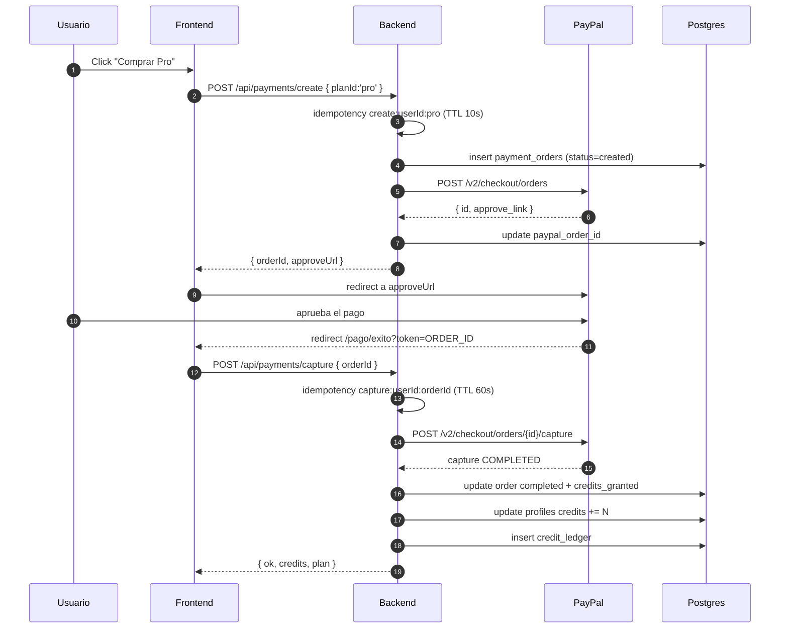
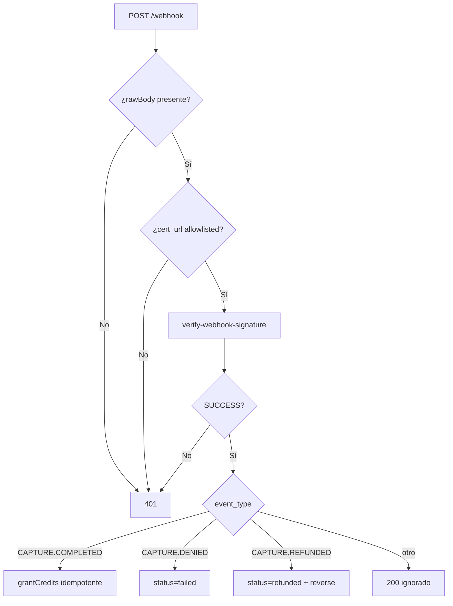
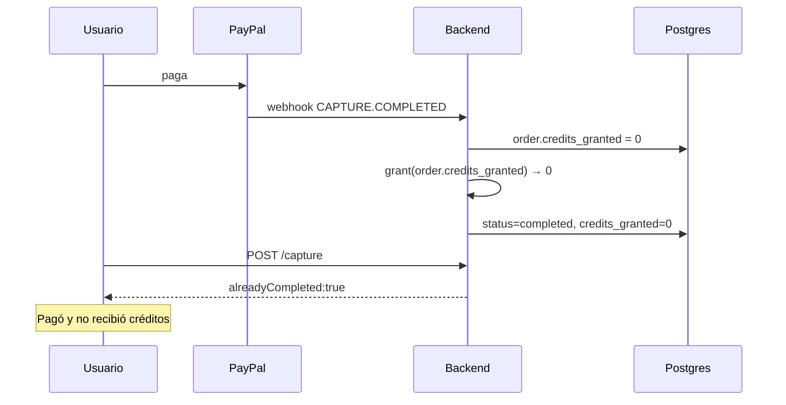

# Flujo de Pagos (PayPal)

> **Archivos:** `src/payments/routes.js`, `paypal-sdk.js`, `webhooks.js`, `idempotency.js`, `database.js`, `schemas.js`, `audit-logger.js`.
> **API externa:** PayPal REST v2 · **Moneda de cargo:** USD.

---

## 1. Catálogo de planes

Fuente: `src/payments/schemas.js`.

| Plan | Precio USD | Precio COP | Créditos | Duración |
|---|---|---|---|---|
| `pro` | 7.50 | 30 000 | 500 | 30 días |
| `ultimate` | 11.00 | 45 000 | 1 200 | 30 días |

```js
export const PLAN_CATALOG = {
  pro:      { id: 'pro',      priceUsd: 7.50,  priceCop: 30000, credits: 500,  days: 30 },
  ultimate: { id: 'ultimate', priceUsd: 11.00, priceCop: 45000, credits: 1200, days: 30 }
};
export const SUBSCRIPTION_DAYS = 30;
```

### Regla de moneda

PayPal **sólo cobra USD** en esta integración. El precio en COP es informativo para la UI colombiana. Si se cobrara COP, el monto debe convertirse y la orden debe declarar `currency_code: 'COP'`; hoy no se hace.

> ⚠️ No aceptes nunca un `amount` enviado por el cliente. El servidor recalcula desde `PLAN_CATALOG` usando el `planId`. Cualquier `amount` del body se ignora.

---

## 2. Visión general



En paralelo, PayPal envía un **webhook** `PAYMENT.CAPTURE.COMPLETED`. Ese webhook es la fuente de verdad cuando el usuario cierra la pestaña antes del `capture`.

---

## 3. Creación de la orden

```http
POST /api/payments/create
Authorization: Cookie (JWT)
Content-Type: application/json

{ "planId": "pro" }
```

### Validación

```js
const Body = z.object({
  planId: z.enum(['pro', 'ultimate'])
});
```

Cualquier otro valor → `400 VALIDATION_ERROR`.

### Construcción del payload PayPal

```js
const plan = PLAN_CATALOG[planId];
const order = await paypal.createOrder({
  intent: 'CAPTURE',
  purchase_units: [{
    reference_id: `${userId.slice(0, 8)}-${planId}`,
    description: `Numination ${planId} — ${plan.credits} créditos`,
    amount: {
      currency_code: 'USD',
      value: plan.priceUsd.toFixed(2)
    }
  }],
  application_context: {
    brand_name: 'Numination',
    user_action: 'PAY_NOW',
    return_url: `${APP_URL}/pago/exito`,
    cancel_url: `${APP_URL}/pago/cancelado`
  }
});
```

| Campo | Por qué |
|---|---|
| `reference_id` | Trazabilidad en el panel de PayPal |
| `description` | Aparece en el recibo del usuario |
| `return_url` | A dónde vuelve tras aprobar |
| `cancel_url` | A dónde vuelve si cancela |

### Respuesta

```json
{
  "ok": true,
  "orderId": "5O190127TN364715T",
  "approveUrl": "https://www.sandbox.paypal.com/checkoutnow?token=5O190127TN364715T",
  "plan": { "id": "pro", "credits": 500, "priceUsd": 7.5 }
}
```

---

## 4. Captura

```http
POST /api/payments/capture
{ "orderId": "5O190127TN364715T" }
```

### Pasos

1. **Idempotencia**: `capture:${userId}:${orderId}`, TTL 60 s.
2. **Cargar orden local** por `paypal_order_id`.
3. **Anti-IDOR**: `String(order.user_id) !== String(userId)` → `403 PAYMENT_ORDER_FORBIDDEN` + `logIdorAttempt`.
4. **Short-circuit**: si `status = 'completed'`, responder `{ ok: true, alreadyCompleted: true }` **sin** volver a llamar a PayPal.
5. **Llamar a PayPal** `POST /v2/checkout/orders/{id}/capture`.
6. **Verificar** `status === 'COMPLETED'` y que el monto capturado coincida con el esperado.
7. **Transacción local**: actualizar orden, sumar créditos, insertar ledger.

```js
await sql.begin(async tx => {
  await tx`
    update payment_orders
    set status = 'completed',
        paypal_capture_id = ${captureId},
        credits_granted = ${plan.credits},
        completed_at = now()
    where id = ${order.id} and status <> 'completed'
  `;
  await tx`
    update profiles set credits = credits + ${plan.credits} where id = ${userId}
  `;
  await tx`
    insert into credit_ledger (user_id, delta, reason, order_id)
    values (${userId}, ${plan.credits}, 'purchase', ${order.id})
    on conflict (order_id, reason) do nothing
  `;
});
```

### Por qué transacción

Si el `update` de la orden funciona y el de créditos falla, el usuario pagó y no recibió nada. La transacción garantiza atomicidad. El `on conflict` del ledger es la segunda barrera contra doble crédito.

### Idempotencia de captura

```js
const key = `capture:${userId}:${orderId}`;
const cached = await idempotency.get(key);
if (cached) return cached;

const result = await doCapture(...);
await idempotency.set(key, result, 60_000);
return result;
```

Tabla:

```sql
create table if not exists payment_idempotency (
  key        text primary key,
  response   jsonb,
  created_at timestamptz default now()
);
```

`insert ... on conflict (key) do nothing` evita la carrera entre dos requests simultáneos. El segundo lee la respuesta del primero.

---

## 5. Webhooks

### 5.1 Registro

PayPal Developer → App → Webhooks → URL:

```
https://numination.app/api/payments/webhook
```

Eventos:

| Evento | Acción |
|---|---|
| `PAYMENT.CAPTURE.COMPLETED` | Otorgar créditos si no se hizo |
| `PAYMENT.CAPTURE.DENIED` | Marcar orden `failed` |
| `PAYMENT.CAPTURE.REFUNDED` | Marcar `refunded`, revertir créditos |
| `CHECKOUT.ORDER.APPROVED` | Registrar aprobación (no acredita) |

### 5.2 Verificación de firma

PayPal firma cada entrega con headers:

| Header | Contenido |
|---|---|
| `paypal-transmission-id` | UUID del intento |
| `paypal-transmission-sig` | Firma RSA |
| `paypal-transmission-time` | ISO 8601 |
| `paypal-cert-url` | URL del certificado |
| `paypal-auth-algo` | `SHA256withRSA` |

**No se verifica localmente.** Se delega a PayPal:

```http
POST https://api-m.paypal.com/v1/notifications/verify-webhook-signature
Authorization: Bearer <access_token>

{
  "auth_algo": "...",
  "cert_url": "...",
  "transmission_id": "...",
  "transmission_sig": "...",
  "transmission_time": "...",
  "webhook_id": "WH-...",
  "webhook_event": { ...evento completo... }
}
```

Respuesta: `{ "verification_status": "SUCCESS" | "FAILURE" }`.

```js
const { verification_status } = await paypal.verifyWebhook(headers, event);
if (verification_status !== 'SUCCESS') {
  return res.status(401).send('Firma inválida.');
}
```

### 5.3 Allowlist de `cert_url`

Antes de enviar a PayPal, se valida el host:

```js
const url = new URL(certUrl);
const ok = ['paypal.com', 'www.paypal.com', 'api.paypal.com', 'paypalobjects.com']
  .some(h => url.hostname === h || url.hostname.endsWith('.' + h));
if (!allowlist.includes(url.hostname)) return res.status(401).send('Firma inválida.');
```

Esto evita SSRF hacia hosts internos si un atacante controla el header.

### 5.4 Requisitos del cuerpo

El webhook **necesita el cuerpo crudo**. `express.json({ verify })` guarda `req.rawBody` sólo para `/api/payments/webhook`. Si se usa `req.body` re-serializado, la firma falla porque el orden de claves y los espacios cambian.

### 5.5 Respuesta

| Situación | Código | Efecto |
|---|---|---|
| Firma válida, procesado | `200` | PayPal no reintenta |
| Firma inválida | `401` | PayPal reintenta |
| Error transitorio de DB | `500` | PayPal reintenta con backoff |
| Evento no manejado | `200` | Se ignora explícitamente |

> Devolver `200` en eventos desconocidos es correcto: si devuelves 4xx, PayPal reintenta indefinidamente un evento que nunca vas a procesar.

### 5.6 Tabla de decisión del handler



---

## 6. Defecto conocido: créditos en 0

### Descripción

En el camino **sólo-webhook**, la orden local puede tener `credits_granted = 0` porque el `capture` HTTP nunca ocurrió. Si el handler del webhook usa `payment.credits_granted` como cantidad a otorgar, otorga **cero**.

Además, si después el cliente llama a `/capture`, el short-circuit `alreadyCompleted: true` impide corregirlo.

### Secuencia del fallo



### Corrección recomendada

1. En el webhook, resolver créditos desde el **plan**, no desde la orden:

```js
const plan = PLAN_CATALOG[order.plan_id];
const credits = plan?.credits ?? 0;
if (credits <= 0) throw new Error('PLAN_NOT_FOUND');
```

2. Otorgar con `where credits_granted = 0` para que sea idempotente:

```sql
update payment_orders
set credits_granted = $1, status = 'completed', completed_at = now()
where id = $2 and credits_granted = 0
returning id;
```

3. Si `rowCount = 0`, no otorgar de nuevo.

4. Script de reparación:

```sql
-- Órdenes completadas sin créditos
select o.id, o.user_id, o.plan_id, o.created_at
from payment_orders o
where o.status = 'completed' and o.credits_granted = 0;
```

---

## 7. Reembolsos

`PAYMENT.CAPTURE.REFUNDED` dispara:

1. Marcar `payment_orders.status = 'refunded'`.
2. Insertar `credit_ledger` con `delta = -credits_granted` y `reason = 'refund'`.
3. Restar créditos del perfil.

```sql
update profiles
set credits = greatest(0, credits - $1)
where id = $2;
```

`greatest(0, ...)` evita saldo negativo si el usuario ya gastó los créditos. La deuda restante se registra en el audit log, no se persigue automáticamente.

**No** se revoca el plan de inmediato salvo que el reembolso cubra el ciclo completo. Eso es una decisión de negocio documentada, no técnica.

---

## 8. Auditoría

```sql
create table if not exists payment_audit_log (
  id         bigserial primary key,
  user_id    uuid,
  order_id   uuid,
  action     text not null,   -- 'create' | 'capture' | 'webhook' | 'idor_attempt' | 'refund'
  metadata   jsonb,
  ip         inet,
  created_at timestamptz default now()
);
```

| Acción | Cuándo |
|---|---|
| `create` | Orden creada en PayPal |
| `capture` | Captura exitosa |
| `webhook` | Evento recibido y verificado |
| `idor_attempt` | Usuario intentó capturar orden ajena |
| `refund` | Reembolso procesado |

`logIdorAttempt(userId, orderId, ip)` registra el intento y **no** lanza excepción: el flujo continúa devolviendo 403.

---

## 9. Seguridad del flujo

| Amenaza | Control |
|---|---|
| Manipular el precio desde el cliente | El servidor recalcula desde `PLAN_CATALOG` |
| Capturar orden ajena (IDOR) | Comparación de `user_id` + 403 + auditoría |
| Repetir un capture | Idempotencia + short-circuit `completed` |
| Webhook falso | Firma verificada por PayPal + allowlist de cert |
| Replay de webhook | `credits_granted = 0` como guardia de idempotencia |
| SSRF vía `cert_url` | Allowlist de dominios |
| Doble crédito por carrera | Transacción + `on conflict` en ledger |
| Fuga de secretos | `PAYPAL_CLIENT_SECRET` sólo en servidor |
| Monto alterado en PayPal | Verificación de `amount.value` contra el plan |

### Verificación del monto

```js
const captured = capture.purchase_units[0].payments.captures[0];
if (Number(captured.amount.value) !== plan.priceUsd) {
  await logAudit('amount_mismatch', { orderId, expected: plan.priceUsd, got: captured.amount.value });
  throw new AppError('AMOUNT_MISMATCH', 400);
}
```

---

## 10. Variables de entorno

| Variable | Requerida | Ejemplo |
|---|---|---|
| `PAYPAL_MODE` | Sí | `sandbox` / `live` |
| `PAYPAL_CLIENT_ID` | Sí | `AX...` |
| `PAYPAL_CLIENT_SECRET` | Sí | `EL...` |
| `PAYPAL_WEBHOOK_ID` | Sí | `WH-...` |
| `APP_URL` | Sí | `https://numination.app` |

### Base URLs

| Modo | API | OAuth |
|---|---|---|
| sandbox | `https://api-m.sandbox.paypal.com` | mismo host |
| live | `https://api-m.paypal.com` | mismo host |

Un `PAYPAL_MODE` mal escrito cae a sandbox por defecto — verifica el valor antes de desplegar.

---

## 11. Pruebas

### Sandbox

1. Cuenta Personal en [developer.paypal.com](https://developer.paypal.com) → Sandbox → Accounts.
2. Usar el comprador de prueba para pagar.
3. Confirmar en el dashboard que la orden aparece `COMPLETED`.

### Casos mínimos

| Caso | Resultado esperado |
|---|---|
| Crear orden `pro` | 200 con `approveUrl` |
| Crear con `planId: 'hack'` | 400 |
| Capturar orden ajena | 403 + audit `idor_attempt` |
| Capturar dos veces | Segunda → `alreadyCompleted: true` |
| Webhook sin firma | 401 `Firma inválida.` |
| Webhook con `cert_url` externo | 401 |
| Webhook `CAPTURE.COMPLETED` | Créditos otorgados una vez |
| Replay del mismo webhook | Sin doble crédito |
| Refund | Créditos restados, saldo ≥ 0 |

### Simular un webhook

```bash
curl -X POST "$APP_URL/api/payments/webhook" \
  -H "Content-Type: application/json" \
  -H "paypal-transmission-id: $TID" \
  -H "paypal-transmission-sig: $SIG" \
  -H "paypal-transmission-time: $TIME" \
  -H "paypal-cert-url: https://api.paypal.com/v1/notifications/certs/$CERT" \
  -H "paypal-auth-algo: SHA256withRSA" \
  --data-binary @event.json
```

Sin firma real de PayPal el resultado correcto es 401.

---

## 12. Operación

### Métricas a vigilar

| Métrica | Query |
|---|---|
| Órdenes creadas vs completadas | `select status, count(*) from payment_orders group by 1` |
| Órdenes completadas sin crédito | `where status='completed' and credits_granted=0` |
| Webhooks fallidos | `select count(*) from payment_audit_log where action='webhook_error'` |
| Intentos IDOR | `where action='idor_attempt'` |
| Ingreso por plan | `select plan_id, sum(amount_usd) from payment_orders where status='completed' group by 1` |

### Runbook: usuario pagó y no tiene créditos

1. Buscar la orden:

```sql
select * from payment_orders where user_id = $1 order by created_at desc limit 5;
```

2. Verificar `status`, `credits_granted`, `paypal_capture_id`.
3. Si `completed` y `credits_granted = 0`:

```sql
begin;
update payment_orders set credits_granted = 500 where id = $orderId and credits_granted = 0;
update profiles set credits = credits + 500 where id = $userId;
insert into credit_ledger (user_id, delta, reason, order_id)
values ($userId, 500, 'manual_repair', $orderId);
commit;
```

4. Registrar el caso en `payment_audit_log` con `action='manual_repair'`.

### Runbook: webhooks fallan masivamente

1. Verificar `PAYPAL_WEBHOOK_ID` correcto.
2. Verificar que `rawBody` llega (log de longitud).
3. Verificar salida a `api-m.paypal.com`.
4. Revisar si PayPal cambió el algoritmo de firma.
5. Reintentar desde el dashboard de PayPal (Webhooks → Resend).

---

## 13. Cumplimiento

| Requisito | Estado |
|---|---|
| No almacenar datos de tarjeta | ✅ PayPal hospeda el checkout |
| Auditoría de transacciones | ✅ `payment_audit_log` |
| Retención ≥ 5 años | ⚠️ Depende de la política de Supabase |
| Reembolsos trazables | ✅ ledger |
| Consentimiento de términos | ⚠️ No implementado en checkout |
| Facturación electrónica (DIAN) | ❌ Pendiente para Colombia |

Ver [`roadmap.md`](./roadmap.md) y [`security.md`](./security.md).
