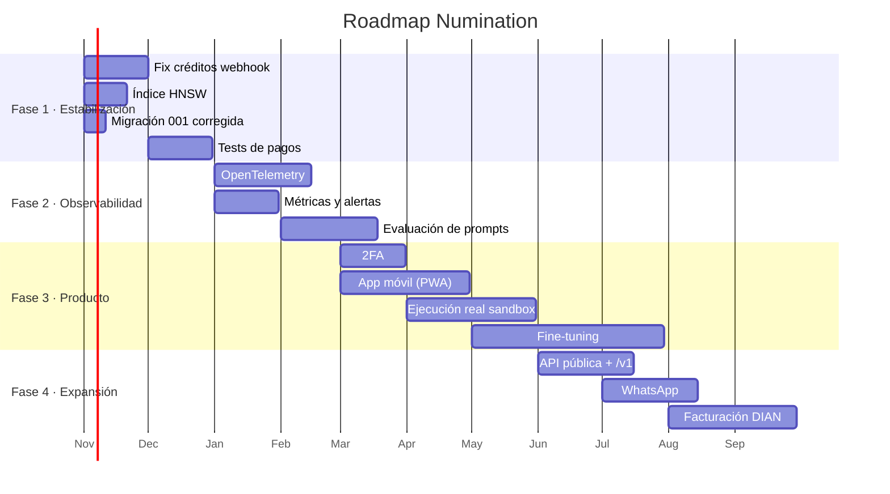

# Roadmap

> **Horizonte:** 12 meses. **Estado base:** v3.3.0 (octubre 2026).
> **Regla:** cada ítem tiene criterio de aceptación verificable. Nada de "mejorar la IA".

---

## 1. Principios de priorización

| Criterio | Peso | Pregunta |
|---|---|---|
| Impacto en ingresos | 30 % | ¿Aumenta conversión o retención? |
| Riesgo mitigado | 25 % | ¿Reduce pérdida de datos, dinero o confianza? |
| Costo de implementación | 20 % | ¿Cuántos días-persona? |
| Deuda técnica | 15 % | ¿Desbloquea trabajo futuro? |
| Diferenciación | 10 % | ¿Nos separa de un wrapper genérico? |

Una funcionalidad nueva no entra si hay un defecto de severidad **Alta** abierto en pagos o seguridad.

---

## 2. Estado actual



---

## 3. Fase 1 — Estabilización (nov–dic 2026)

### 1.1 Corregir créditos en webhook-only

| Campo | Detalle |
|---|---|
| Problema | El webhook otorga 0 créditos si `credits_granted` aún es 0 |
| Impacto | Usuarios pagan y no reciben nada |
| Solución | Resolver créditos desde `PLAN_CATALOG`, no desde la orden |
| Aceptación | Test que simula webhook sin capture previo y verifica 500 créditos |
| Archivos | `src/payments/webhooks.js`, `src/payments/schemas.js` |
| Esfuerzo | 1–2 días |

```js
const plan = PLAN_CATALOG[order.plan_id];
if (!plan) throw new Error('PLAN_NOT_FOUND');

await sql.begin(async tx => {
  const updated = await tx`
    update payment_orders
    set credits_granted = ${plan.credits}, status = 'completed', completed_at = now()
    where id = ${order.id} and credits_granted = 0
    returning id
  `;
  if (!updated.length) return;
  await tx`update profiles set credits = credits + ${plan.credits} where id = ${order.user_id}`;
  await tx`insert into credit_ledger (user_id, delta, reason, order_id)
           values (${order.user_id}, ${plan.credits}, 'purchase', ${order.id})
           on conflict (order_id, reason) do nothing`;
});
```

### 1.2 Índice vectorial

| Campo | Detalle |
|---|---|
| Problema | `rag_chunks.embedding` sin índice → seq scan |
| Solución | HNSW con `m=16`, `ef_construction=64` |
| Aceptación | `explain analyze` muestra `Index Scan`; p95 < 50 ms con 10k chunks |
| Esfuerzo | 1 día |

### 1.3 Migración 001

| Campo | Detalle |
|---|---|
| Problema | Apunta a `messages`, el runtime usa `"Message"` |
| Solución | Corregir nombre y añadir guardia `if exists` |
| Aceptación | `npm run migrate` en DB limpia no falla |
| Esfuerzo | 2 horas |

### 1.4 Tests de pagos

| Caso | Verifica |
|---|---|
| Create pro | Orden creada, monto correcto |
| Create plan inválido | 400 |
| Capture ajena | 403 + audit |
| Capture doble | `alreadyCompleted` |
| Webhook sin firma | 401 |
| Webhook replay | Sin doble crédito |
| Refund | Saldo ≥ 0 |

**Aceptación:** suite verde en CI, cobertura de `src/payments` ≥ 70 %.

### 1.5 Columna `provider` en `"Message"`

Permite analizar calidad por modelo y depurar fallbacks.

```sql
alter table "Message" add column if not exists provider text;
alter table "Message" add column if not exists model text;
create index if not exists idx_message_provider on "Message" (provider);
```

**Esfuerzo:** 1 día (más backfill opcional).

---

## 4. Fase 2 — Observabilidad (ene–feb 2027)

### 2.1 Trazas con OpenTelemetry

| Campo | Detalle |
|---|---|
| Objetivo | Ver una request completa: HTTP → auth → IA → DB |
| Implementación | `@opentelemetry/sdk-node`, exporter OTLP |
| Aceptación | Una traza de chat muestra al menos 5 spans con duración |
| Esfuerzo | 10 días |

Spans mínimos:

```text
POST /api/chat/stream
├── auth.verify            12 ms
├── db.load_chat            8 ms
├── rag.search             45 ms
├── ai.groq.stream       1200 ms
└── db.save_message        15 ms
```

### 2.2 Métricas y alertas

| Métrica | Alerta |
|---|---|
| `http_request_duration_p95` | > 3 s |
| `ai_fallback_total` | > 10/min |
| `payment_webhook_failures` | > 3 en 10 min |
| `db_pool_waiting` | > 5 |
| `credits_debit_errors` | > 0 |

**Aceptación:** dashboard con 6 paneles y 4 alertas activas.

### 2.3 Evaluación de prompts

| Campo | Detalle |
|---|---|
| Objetivo | Detectar regresiones al cambiar modelo o prompt |
| Implementación | Golden set de 100 prompts + juez LLM + comparación |
| Aceptación | CI falla si la puntuación baja > 5 % |
| Esfuerzo | 20 días |

### 2.4 Caché compartido

Mover `src/lib/cache.js` a Redis o Postgres para que el rate limit y los cooldowns sobrevivan a cold starts.

---

## 5. Fase 3 — Producto (mar–may 2027)

### 3.1 2FA (TOTP)

| Campo | Detalle |
|---|---|
| Objetivo | Proteger cuentas con créditos |
| Implementación | `otplib`, secreto cifrado, códigos de respaldo |
| Aceptación | Login exige código si está activo; recuperación funciona |
| Esfuerzo | 10 días |

### 3.2 PWA instalable

| Campo | Detalle |
|---|---|
| Objetivo | Presencia móvil sin app nativa |
| Implementación | `manifest.json`, service worker, cache offline del shell |
| Aceptación | Instalable en Android/iOS; shell carga offline |
| Esfuerzo | 15 días |

### 3.3 Ejecución real en sandbox

| Campo | Detalle |
|---|---|
| Objetivo | Correr código de usuario sin riesgo |
| Opciones | WebContainer (cliente) o Firecracker (servidor) |
| Recomendación | WebContainer: cero riesgo en servidor, sin costo de cómputo |
| Aceptación | `node index.js` ejecuta y devuelve stdout real |
| Esfuerzo | 30 días |

> No se hará con `child_process` en el host bajo ninguna circunstancia.

### 3.4 Fine-tuning / adaptadores

| Campo | Detalle |
|---|---|
| Objetivo | Mejorar estilo y precisión en dominios concretos |
| Implementación | Dataset de conversaciones aprobadas + LoRA |
| Aceptación | Mejora medible en el golden set sin degradar seguridad |
| Esfuerzo | 45 días |

> Requiere consentimiento explícito para usar conversaciones como datos de entrenamiento. Ver [`security.md`](./security.md).

---

## 6. Fase 4 — Expansión (jun–ago 2027)

### 4.1 API pública `/v1`

| Campo | Detalle |
|---|---|
| Objetivo | Permitir integraciones de terceros |
| Implementación | API keys, versionado, docs interactivas, rate limit por key |
| Aceptación | Un tercero puede chatear con `curl` usando sólo su key |
| Esfuerzo | 25 días |

Cambios necesarios:

- Prefijo `/v1` con rewrite.
- `api_keys` con hash y scopes.
- OpenAPI 3.1 generado desde Zod.
- Portal de desarrolladores.

### 4.2 WhatsApp

| Campo | Detalle |
|---|---|
| Objetivo | Capturar usuarios fuera de la web |
| Implementación | WhatsApp Cloud API + webhook |
| Aceptación | Conversación bidireccional con memoria |
| Esfuerzo | 25 días |

### 4.3 Facturación electrónica (DIAN)

| Campo | Detalle |
|---|---|
| Objetivo | Cumplir con Colombia para cobros locales |
| Implementación | Proveedor certificado (Factus, Alegra) |
| Aceptación | Cada pago genera factura válida ante la DIAN |
| Esfuerzo | 30 días |

---

## 7. Ideas evaluadas y descartadas

| Idea | Por qué no (todavía) |
|---|---|
| App nativa iOS/Android | PWA cubre el 80 % con 10 % del costo |
| Editor con Monaco | Pesa 5 MB; el textarea actual basta |
| Kubernetes | Un monolito no necesita orquestación |
| Microservicios | Añade latencia y complejidad sin beneficio actual |
| Blockchain / tokens | Ningún problema real del usuario lo requiere |
| Modelo propio desde cero | Costo de entrenamiento > valor diferencial |
| Marketplace de agentes | Requiere masa crítica que aún no existe |
| Voz en tiempo real | Dependencia de proveedor costoso; evaluar en 2028 |

---

## 8. Deuda técnica priorizada

| # | Deuda | Severidad | Fase |
|---|---|---|---|
| 1 | Créditos 0 en webhook | Alta | 1 |
| 2 | Sin índice vectorial | Media | 1 |
| 3 | Migración 001 rota | Alta | 1 |
| 4 | Sin tests de pagos | Alta | 1 |
| 5 | `main.js` 2 034 LOC | Media | 2 |
| 6 | `style-src unsafe-inline` | Baja | 2 |
| 7 | Sin cobertura medida | Media | 2 |
| 8 | Caché por instancia | Media | 2 |
| 9 | SQL crudo en `chats.js` | Media | 3 |
| 10 | Sin virtualización de listas | Baja | 3 |

---

## 9. Métricas de éxito

### Producto

| Métrica | Hoy (estimado) | 12 meses |
|---|---|---|
| Usuarios registrados | — | 10 000 |
| Activos mensuales | — | 2 500 |
| Conversión free → pago | — | 4 % |
| Retención D30 | — | 35 % |
| Chats por usuario activo | — | 40/mes |

### Técnicas

| Métrica | Hoy | 12 meses |
|---|---|---|
| p95 de latencia HTTP | — | < 800 ms |
| TTFT | — | < 1 s |
| Uptime | — | 99.5 % |
| Cobertura de tests | ~0 % | 60 % |
| Errores 5xx | — | < 0.5 % |

### Negocio

| Métrica | 12 meses |
|---|---|
| MRR | Definir objetivo con el titular |
| Churn mensual | < 6 % |
| LTV/CAC | > 3 |

---

## 10. Riesgos del roadmap

| Riesgo | Probabilidad | Impacto | Mitigación |
|---|---|---|---|
| Proveedor de IA cambia precios | Alta | Alto | Cadena multi-proveedor ya implementada |
| Límite de Vercel bloquea streaming | Media | Alto | Plan de migración a VPS documentado |
| Costos de tokens superan ingresos | Media | Alto | Créditos + límites + monitoreo |
| Complejidad de DIAN | Alta | Medio | Usar proveedor certificado |
| Baja conversión | Media | Alto | Precios ya definidos; experimentar |
| Fuga de datos | Baja | Crítico | Auditoría + cifrado + 2FA |

---

## 11. Cómo se decide qué sigue

1. Revisión mensual de métricas.
2. Lista de candidatos con estimación.
3. Puntuación con la matriz de la sección 1.
4. Si hay un bug de severidad Alta, se antepone todo.
5. Se documenta la decisión y se actualiza este archivo.

**No** se aceptan funcionalidades sin criterio de aceptación escrito.

---

## 12. Lo que no va a pasar

Para evitar expectativas falsas:

- No habrá versión gratuita ilimitada.
- No se ejecutará código arbitrario en el servidor.
- No se entrenará con datos de usuarios sin consentimiento explícito.
- No se venderán datos a terceros.
- No habrá licencia open source del núcleo.
- No se promete disponibilidad 99.99 % con la infraestructura actual.

*Ver [`contributing.md`](./contributing.md) para el proceso de propuesta.*
