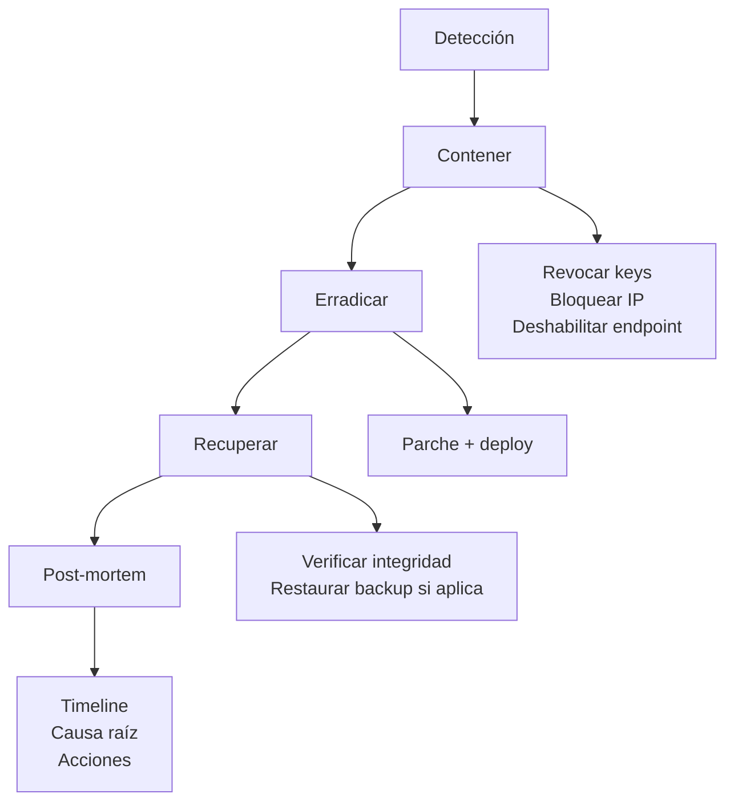

# Seguridad

> **Alcance:** autenticación, autorización, rate limiting, moderación, validación, secretos, XSS, IDOR, webhooks, dependencias.
> **Filosofía:** fail-closed en dinero, fail-open en moderación, capas redundantes.

---

## 1. Modelo de amenazas

| Activo | Amenaza | Impacto | Control |
|---|---|---|---|
| Cuentas | Credential stuffing | Alto | Rate limit + bcrypt + verificación email |
| Chats/memorias | IDOR | Alto | `WHERE user_id = $1` en toda query |
| Créditos | Manipulación | Alto | Cálculo server-side + ledger |
| Pagos | Fraude / replay | Crítico | Firma PayPal + idempotencia |
| Prompts | Injection | Medio | Delimitación + validación de personas |
| UI | XSS | Alto | `escapeHTML` + CSP |
| Infra | Fuga de secretos | Crítico | `.env` no versionado |
| API | Abuso / scraping | Medio | Rate limit por capas + ban manager |

### Fuera de alcance

- Ataques físicos.
- Compromiso del proveedor cloud.
- Ingeniería social contra el titular.
- DDoS volumétrico (lo absorbe Vercel/Cloudflare, no la app).

---

## 2. Autenticación

### 2.1 Métodos

| Método | Flujo | Token |
|---|---|---|
| Email + password | `POST /api/auth/register` → `POST /api/auth/login` | JWT en cookie `HttpOnly` |
| Google OAuth | `GET /api/auth/google` → callback | JWT en cookie |
| GitHub OAuth | `GET /api/auth/github` → callback | JWT en cookie |

### 2.2 Hash de contraseñas

```js
const hash = await bcrypt.hash(password, 12);
const ok = await bcrypt.compare(password, user.password_hash);
```

| Parámetro | Valor | Motivo |
|---|---|---|
| Algoritmo | bcrypt | Estándar, resistente a GPU |
| Cost | 12 | ~250 ms en hardware moderno |
| Longitud mínima | 8 | Con verificación de complejidad |
| Longitud máxima | 72 bytes | Límite de bcrypt (truncamiento silencioso) |

> Si la contraseña excede 72 bytes y no se rechaza, dos contraseñas distintas con el mismo prefijo son equivalentes. Se valida en Zod.

### 2.3 JWT

```js
const token = jwt.sign(
  { sub: user.id, plan: user.plan, role: user.role, jti: crypto.randomUUID() },
  config.auth.jwtSecret,
  { expiresIn: '30d', issuer: 'numination', audience: 'web' }
);
```

| Claim | Uso |
|---|---|
| `sub` | ID de usuario |
| `plan` | Cacheado; se revalida contra DB en operaciones sensibles |
| `role` | `user` / `admin` |
| `jti` | Permite revocación individual |
| `exp` | 30 días |
| `iss` / `aud` | Validados en `jwt.verify` |

### 2.4 Cookie

```js
res.cookie('token', token, {
  httpOnly: true,
  secure: config.env === 'production',
  sameSite: 'lax',
  maxAge: 30 * 24 * 3600 * 1000,
  path: '/'
});
```

| Flag | Por qué |
|---|---|
| `HttpOnly` | Bloquea robo por XSS |
| `Secure` | Sólo HTTPS en producción |
| `SameSite=Lax` | Mitiga CSRF en navegación cross-site |
| `path=/` | Disponible en toda la app |

> `SameSite=Lax` permite el retorno de OAuth (navegación top-level) pero bloquea POST cross-site. Es el balance correcto para este flujo.

### 2.5 Revocación

```sql
create table if not exists revoked_sessions (
  jti        text primary key,
  user_id    uuid not null,
  revoked_at timestamptz default now(),
  expires_at timestamptz not null
);
```

En cada request autenticada:

```js
const [revoked] = await sql`select 1 from revoked_sessions where jti = ${payload.jti}`;
if (revoked) return res.status(401).json({ ok: false, code: 'SESSION_REVOKED' });
```

> Costo: una query extra por request. Se puede cachear en memoria 60 s por `jti` si el volumen lo exige.

### 2.6 OAuth

| Control | Implementación |
|---|---|
| `state` | UUID aleatorio guardado en cookie firmada |
| Validación de `state` | Comparación en callback; si difiere → 400 |
| Email verificado | Se exige `email_verified` de Google |
| Vinculación de cuentas | Por email verificado, no por nombre |
| Scopes mínimos | `openid email profile` |

```js
// callback
if (req.query.state !== req.cookies.oauth_state) {
  return res.status(400).json({ ok: false, code: 'INVALID_STATE' });
}
```

Sin `state`, un atacante puede forzar el login a **su** cuenta (login CSRF) y el usuario termina escribiendo en la cuenta del atacante.

---

## 3. Autorización

### 3.1 Regla de propiedad

Toda entidad con `user_id` se consulta así:

```sql
select * from "Chat" where id = $1 and user_id = $2
```

Nunca:

```sql
select * from "Chat" where id = $1   -- ❌ luego se compara en JS
```

La comparación en JS es frágil: un `return` temprano olvidado expone datos. Filtrar en SQL es atómico.

### 3.2 Roles

| Rol | Puede |
|---|---|
| `user` | Todo sobre sus propios recursos |
| `admin` | Todo + panel `/api/admin/*` |

```js
export function requireAdmin(req, res, next) {
  if (req.user?.role !== 'admin') {
    return res.status(403).json({ ok: false, code: 'FORBIDDEN' });
  }
  next();
}
```

### 3.3 Planes

```js
export const requirePlan = (...plans) => (req, res, next) => {
  if (!plans.includes(req.user?.plan)) {
    return res.status(402).json({ ok: false, code: 'PLAN_REQUIRED', required: plans });
  }
  next();
};
```

> El plan del JWT puede estar desactualizado tras una compra. En endpoints que otorgan features premium se relee de DB.

### 3.4 IDOR: el caso de pagos

```js
if (String(payment.user_id) !== String(userId)) {
  await logIdorAttempt({ userId, orderId, ip: req.ip });
  return res.status(403).json({ ok: false, code: 'PAYMENT_ORDER_FORBIDDEN' });
}
```

`String()` a ambos lados evita el clásico `'abc' !== new String('abc')` y también cubre UUIDs devueltos como objetos por el driver.

---

## 4. Rate limiting

### 4.1 Capas

| Capa | Ventana | Límite | Archivo |
|---|---|---|---|
| Global por IP | 60 s | 500 | `src/index.js` |
| `ipGuard` chat stream | 60 s | 60 | `src/middleware/ip-guard.js` |
| `ipGuard` login | 5 min | 10 | idem |
| `ipGuard` register | 15 min | 5 | idem |
| Por usuario/plan | 60 s | según plan | `rate-limiter.js` |
| `strictRateLimiter` | 60 s | 10 | operaciones sensibles |
| `aiRateLimiter` | 60 s | 20 | llamadas a IA |

```js
export const globalLimiter = rateLimit({
  windowMs: 60_000,
  max: 500,
  standardHeaders: true,
  legacyHeaders: false,
  keyGenerator: req => req.ip
});

export const strictRateLimiter = rateLimit({ windowMs: 60_000, max: 10 });
export const aiRateLimiter     = rateLimit({ windowMs: 60_000, max: 20 });
```

### 4.2 Por qué varias capas

Una sola capa no distingue entre "listar chats" (barato) y "generar con IA" (caro). El límite global protege la infraestructura; el de IA protege el presupuesto.

### 4.3 `trust proxy`

```js
app.set('trust proxy', 1);
```

Sin esto, detrás de Vercel todas las requests parecen venir de la misma IP y el límite bloquearía a todos. Con `1`, Express confía en el primer proxy y usa `X-Forwarded-For`.

> ⚠️ Si el servidor es accesible directo (sin proxy), un atacante puede falsificar `X-Forwarded-For` y evadir el límite. En esa topología, `trust proxy` debe ser `false`.

---

## 5. Moderación y ban manager

`src/middleware/ban-manager.js`.

| Señal | Puntos |
|---|---|
| Contenido bloqueado por proveedor | +25 |
| Reporte de usuario | +40 |
| Patrón de spam | +30 |
| Intento de jailbreak repetido | +20 |

| Umbral | Acción |
|---|---|
| `risk_score >= 80` | Suspensión 24 h |
| `strikes >= 2` | Advertencia |
| `strikes >= 3` | Suspensión 24 h |

```js
if (moderation.suspended_until && new Date(moderation.suspended_until) > new Date()) {
  return res.status(403).json({
    ok: false,
    code: 'ACCOUNT_SUSPENDED',
    until: moderation.suspended_until
  });
}
```

La suspensión es **fail-open ante errores de DB**: si la consulta falla, se deja pasar y se registra el error. Bloquear a todos por una caída de DB es peor que dejar pasar a un abusador por unos minutos.

---

## 6. Validación de entrada

### 6.1 Zod en el borde

```js
const CreateChat = z.object({
  title: z.string().trim().min(1).max(120).optional(),
  personaId: z.string().uuid().optional()
});

const body = CreateChat.parse(req.body);
```

| Regla | Aplicación |
|---|---|
| Strings | `.trim()` + `.max()` siempre |
| IDs | `.uuid()` |
| Enums | `.enum([...])` |
| Números | `.int().min().max()` |
| Fechas | ISO 8601 |
| Archivos | MIME + tamaño + magic bytes |

### 6.2 Límites de payload

```js
app.use(express.json({ limit: '12mb' }));
app.use(express.urlencoded({ extended: true, limit: '2mb' }));
```

12 MB permite pegar documentos largos sin permitir un DoS trivial.

### 6.3 SQL

Todas las queries usan tagged templates de `postgres.js`, que parametrizan automáticamente:

```js
await sql`select * from "Chat" where user_id = ${userId}`  // ✅
await sql.unsafe(`select * from "Chat" where user_id = '${userId}'`) // ❌ nunca
```

Regla: `sql.unsafe` sólo se permite con strings constantes sin interpolación. Si necesitas ordenamiento dinámico, valida contra una whitelist:

```js
const SORTS = { created: 'created_at', updated: 'updated_at' };
const col = SORTS[req.query.sort] ?? 'updated_at';
await sql`select * from "Chat" where user_id = ${userId} order by ${sql(col)} desc`;
```

---

## 7. XSS y frontend

### 7.1 El problema

El chat renderiza Markdown generado por un modelo. Ese contenido puede incluir HTML. Si se inyecta con `innerHTML` sin sanear, es XSS almacenado.

### 7.2 Defensa en profundidad

1. **Escapar** todo texto antes de insertarlo.
2. **Sanear URLs** en enlaces e imágenes.
3. **CSP** que bloquea scripts inline.
4. **Cookie HttpOnly** para que un XSS no robe el token.

```js
export function escapeHTML(s) {
  return String(s)
    .replace(/&/g, '&amp;')
    .replace(/</g, '&lt;')
    .replace(/>/g, '&gt;')
    .replace(/"/g, '&quot;')
    .replace(/'/g, '&#39;');
}

export function sanitizeURL(url) {
  try {
    const u = new URL(url, location.origin);
    if (!['http:', 'https:', 'mailto:'].includes(u.protocol)) return '#';
    return u.toString();
  } catch {
    return '#';
  }
}
```

`sanitizeURL` bloquea `javascript:`, `data:` y `vbscript:`, que son los vectores clásicos en `href` y `src`.

### 7.3 CSP

```http
Content-Security-Policy:
  default-src 'self';
  script-src 'self' https://cdn.jsdelivr.net;
  style-src 'self' 'unsafe-inline';
  img-src 'self' data: https:;
  connect-src 'self' https://api.numination.app;
  frame-ancestors 'none';
  base-uri 'self';
  form-action 'self'
```

| Directiva | Protege contra |
|---|---|
| `script-src` sin `unsafe-inline` | XSS por `<script>` inyectado |
| `frame-ancestors 'none'` | Clickjacking |
| `base-uri 'self'` | Secuestro de URLs relativas |
| `form-action 'self'` | Exfiltración por formulario |

> `style-src 'unsafe-inline'` es necesario porque `escritura.js` inyecta un `<style>` en tiempo de ejecución (línea ~447). Es deuda técnica: mover esos estilos a una hoja externa permitiría endurecer la CSP.

### 7.4 `innerHTML` auditables

| Archivo | Uso | Riesgo |
|---|---|---|
| `escritura.js` | Render de Markdown | Saneado con `escapeHTML` |
| `main.js` | Lista de chats | Usa `textContent` |
| `coder.js` | Resaltado | Escapa antes de resaltar |
| `admin.js` | Tablas | Revisar en cada cambio |

Regla de revisión: cualquier PR que añada `innerHTML` debe mostrar en la descripción **de dónde** viene el dato y **cómo** se escapa.

---

## 8. CSRF

| Vector | Mitigación |
|---|---|
| POST cross-site con cookie | `SameSite=Lax` |
| Formularios cross-site | `form-action 'self'` |
| Peticiones con `Origin` ajeno | Verificación de `Origin`/`Referer` en mutaciones sensibles |

```js
const origin = req.get('origin');
if (origin && !ALLOWED_ORIGINS.includes(origin)) {
  return res.status(403).json({ ok: false, code: 'BAD_ORIGIN' });
}
```

> Los endpoints de API se consumen con `fetch` desde el mismo origen. Un token CSRF explícito sería más robusto, pero `SameSite=Lax` + `Origin` cubre el caso actual.

---

## 9. CORS

```js
const allowlist = [
  'https://numination.app',
  'https://www.numination.app',
  'https://numinationchat.vercel.app',
  ...(config.env !== 'production' ? ['http://localhost:8080'] : [])
];

app.use(cors({
  origin(origin, cb) {
    if (!origin) return cb(null, true);          // curl / server-to-server
    if (allowlist.includes(origin)) return cb(null, true);
    return cb(new Error('CORS_NOT_ALLOWED'));
  },
  credentials: true
}));
```

`credentials: true` es obligatorio para enviar cookies, y exige que `origin` **nunca** sea `*`.

---

## 10. Secretos

### 10.1 Reglas

| Regla | Detalle |
|---|---|
| Nunca en el repo | `.env*` en `.gitignore` |
| Nunca en el cliente | Sólo variables sin prefijo público |
| Rotación | Al menos cada 90 días para JWT y PayPal |
| Alcance mínimo | Cada key sólo para su proveedor |
| Separación | Sandbox ≠ producción |

### 10.2 `.gitignore`

```gitignore
.env
.env.*
!.env.example
env.local.js
*.pem
*.key
```

### 10.3 Si se filtra una key

1. **Revocar** en el proveedor (primer minuto).
2. Generar una nueva.
3. Actualizar el entorno de producción.
4. Buscar uso indebido en los logs del proveedor.
5. Si es `JWT_SECRET`: **todos** los usuarios quedan deslogueados (es el efecto deseado).
6. Documentar el incidente.

### 10.4 Verificación pre-commit

```bash
git diff --cached | grep -Ei 'sk-[a-z0-9]{20,}|AIza[0-9A-Za-z_-]{35}|EL[0-9A-Za-z]{30,}'
```

Si hay match, **no** hagas commit.

---

## 11. Webhooks

| Control | Implementación |
|---|---|
| Firma | Verificación delegada a PayPal |
| Allowlist de cert | Sólo `paypal.com` / `paypalobjects.com` |
| Cuerpo crudo | `req.rawBody` |
| Idempotencia | `credits_granted = 0` + ledger único |
| Timeout | 10 s |
| Respuesta a desconocidos | 200 |

### Webhooks salientes (usuarios)

| Control | Implementación |
|---|---|
| URL | Sólo `https://`, sin IPs privadas |
| Firma | HMAC-SHA256 con secreto por endpoint |
| Reintentos | 3 con backoff exponencial |
| Timeout | 8 s |
| Registro | `webhook_deliveries` |

```js
const signature = crypto
  .createHmac('sha256', endpoint.secret)
  .update(JSON.stringify(payload))
  .digest('hex');

await fetch(endpoint.url, {
  method: 'POST',
  headers: {
    'Content-Type': 'application/json',
    'X-Numination-Signature': `sha256=${signature}`,
    'X-Numination-Timestamp': String(Date.now())
  },
  body: JSON.stringify(payload),
  signal: AbortSignal.timeout(8000)
});
```

Bloquear IPs privadas evita SSRF contra la red interna (`169.254.169.254` en cloud).

---

## 12. Cabeceras de seguridad

| Cabecera | Valor |
|---|---|
| `X-Content-Type-Options` | `nosniff` |
| `X-Frame-Options` | `DENY` |
| `Referrer-Policy` | `strict-origin-when-cross-origin` |
| `Permissions-Policy` | `camera=(), microphone=(self), geolocation=()` |
| `Strict-Transport-Security` | `max-age=31536000; includeSubDomains` |
| `X-Request-Id` | UUID por request |

`helmet` se aplica en modo "lite" (headers manuales) para no romper el SSE ni el frontend existente.

---

## 13. Logging y privacidad

### Qué se registra

| Campo | Ejemplo |
|---|---|
| `requestId` | UUID |
| `method`, `path` | `POST /api/chat/stream` |
| `status` | 200 |
| `ms` | 1234 |
| `userId` | UUID (nunca email) |
| `ip` | Truncada a /24 en producción |

### Qué **no** se registra

- Contenido de mensajes.
- Contraseñas o hashes.
- Tokens JWT completos.
- Claves de API.
- Cuerpo de webhooks con datos personales.

```js
logger.info({ requestId, method, path, status, ms, userId });
// nunca: logger.info({ body: req.body })
```

---

## 14. Dependencias

```bash
npm audit --omit=dev
npm audit fix
```

| Práctica | Frecuencia |
|---|---|
| `npm audit` | Cada PR / semanal |
| Actualizar parches | Mensual |
| Revisar nuevas dependencias | Antes de instalar |
| Lockfile committed | Siempre |
| Sin `postinstall` arbitrario | Revisar antes de `npm ci` |

### Criterios para aceptar una dependencia

1. Mantenida (commit en los últimos 12 meses).
2. Descargas razonables.
3. Sin scripts de instalación sospechosos.
4. Licencia compatible con software propietario.
5. Tamaño justificado.

---

## 15. Checklist de revisión de seguridad

### Backend

- [ ] ¿Toda query filtra por `user_id`?
- [ ] ¿Se validó el body con Zod?
- [ ] ¿El endpoint sensible tiene `strictRateLimiter`?
- [ ] ¿Se registra el intento IDOR?
- [ ] ¿La operación de dinero es transaccional e idempotente?
- [ ] ¿Se verifica el monto contra el catálogo?
- [ ] ¿El webhook exige `rawBody`?
- [ ] ¿Se validó `cert_url`?
- [ ] ¿Los errores no filtran stack en producción?

### Frontend

- [ ] ¿Se escapa antes de `innerHTML`?
- [ ] ¿Se sanea toda URL dinámica?
- [ ] ¿No hay secretos en el bundle?
- [ ] ¿El token está en cookie `HttpOnly`?
- [ ] ¿Los formularios validan antes de enviar (UX, no seguridad)?

### Infra

- [ ] ¿`.env` fuera del repo?
- [ ] ¿HTTPS forzado?
- [ ] ¿`JWT_SECRET` de 64+ bytes?
- [ ] ¿Backups cifrados?
- [ ] ¿Acceso a Supabase restringido?

---

## 16. Respuesta a incidentes



| Fase | Tiempo objetivo |
|---|---|
| Contención | < 15 min |
| Erradicación | < 2 h |
| Recuperación | < 4 h |
| Post-mortem | < 72 h |

### Contacto

El titular es el único punto de contacto de seguridad. No hay bug bounty formal; los reportes se evalúan caso por caso.

---

## 17. Deuda de seguridad conocida

| # | Riesgo | Severidad | Estado |
|---|---|---|---|
| 1 | Créditos 0 en webhook-only | Alta | Documentado, pendiente fix |
| 2 | `style-src 'unsafe-inline'` | Baja | Deuda de `escritura.js` |
| 3 | Sin CSRF token explícito | Baja | Mitigado por `SameSite` |
| 4 | Sin 2FA | Media | Roadmap |
| 5 | Sin cifrado a nivel de columna en memorias | Media | Roadmap |
| 6 | Sin WAF propio | Baja | Vercel cubre parcialmente |

*Siguiente: [`api-reference.md`](./api-reference.md) para los contratos, y [`troubleshooting.md`](./troubleshooting.md) para la operación.*
